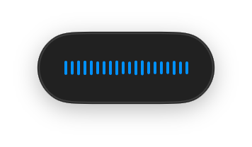
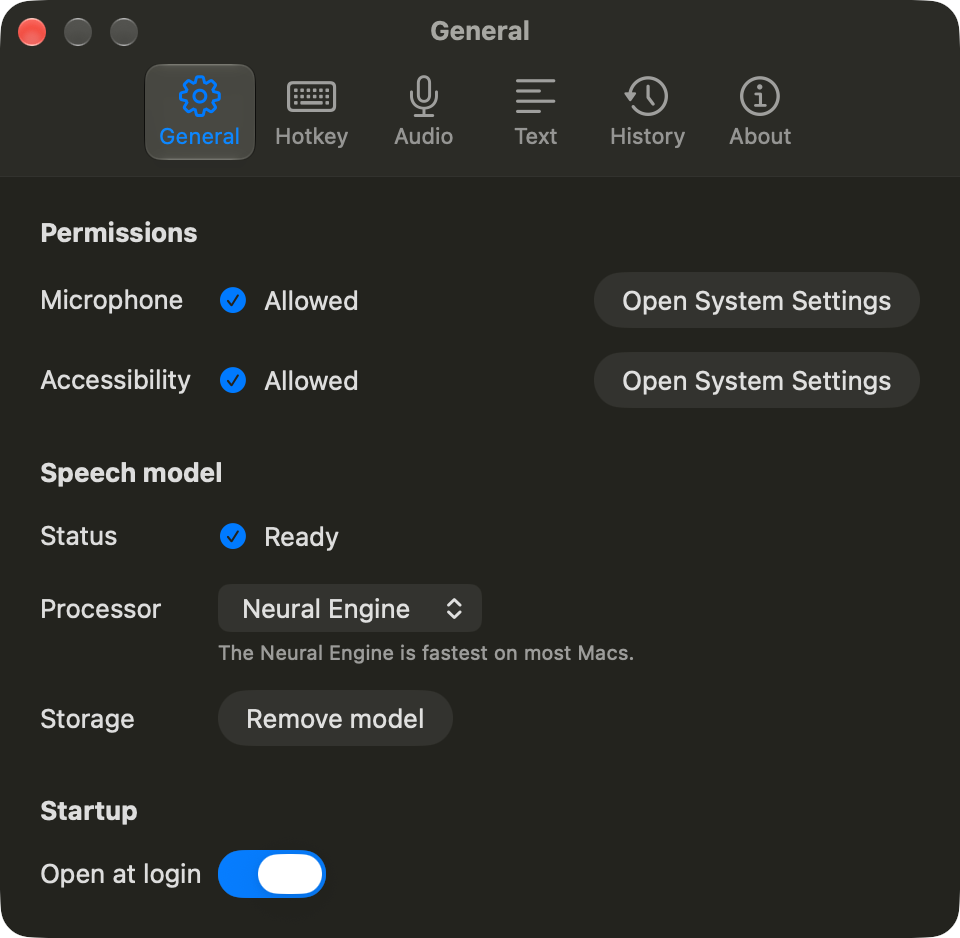

# Local Dictation

[](https://github.com/exgota/local-dictation/actions/workflows/continuous-integration.yml)

Dictation for macOS that runs entirely on your Mac, built for people who prompt AI tools by voice. Press Fn, talk, press
Fn again, and the text appears where your cursor is. It uses no cloud service and needs no account.



It uses Underdog Bark 3.0 Pro, a 0.6B-parameter Parakeet speech model, on Core ML. It transcribes while you speak, so
the text lands 0.2 to 0.3 s after you press Fn to stop. In measurements, a five-minute dictation transcribed in about two
seconds, with under 1% word error rate. [docs/SPEC.md](docs/SPEC.md) lists the measurements.

## What it does

- Fn starts and stops dictation. Escape cancels it. Settings offers hold-to-talk and other trigger keys.
- The text goes into the app you were using. If focus moved while you spoke, if no text field has focus, or if Local
  Dictation cannot confirm that the text arrived, a small panel with a Copy button shows the text instead, and the text
  is also placed on the clipboard. A password field never receives text: the panel shows it, and the clipboard is not
  changed.
- When the text is inserted, your clipboard is left as it was.
- Slack, Discord, Telegram, WhatsApp and Messages get light cleanup. Fillers such as "um" are removed, spoken
  commands such as "comma" and "new line" become punctuation, sentences are capitalized, a final period is added,
  and saying "scratch that" deletes the sentence you just spoke. Every other app gets exactly what you said, and
  password managers get no text. Settings lets you choose a style for each app.
- Each dictation can be saved as a Markdown file in a dated folder, by default `~/Desktop/Transcripts/<date>/`, easy
  for agents to read.
- The microphone is on only while you dictate.



## Requirements

- A Mac with Apple Silicon, macOS 15 or later
- About 1.3 GB of disk space for the installed speech model, and about 2.5 GB free while it installs, because the
  downloaded files stay on disk until every component is compiled
- Xcode with the Swift 6.2 toolchain or later, to build from source

## Install

### Build from source

```sh
git clone https://github.com/exgota/local-dictation.git
cd local-dictation
./build_application.sh
```

The script builds the app, signs it and installs it to `~/Applications/Local Dictation.app`. It signs with the
code-signing identity named Local Dictation Development when your keychain has one. Without that identity the app is
signed ad hoc, and macOS asks for its permissions again after every rebuild. [BUILD.md](BUILD.md) outlines how to
create the identity so the permissions persist.

### Prebuilt copy

Download `Local-Dictation.zip` from [Releases](https://github.com/exgota/local-dictation/releases) and unzip it. The
app is not notarized by Apple, so macOS blocks the first launch. Move the app to `~/Applications` or `/Applications`
first, then:

1. Open it once. macOS says it cannot verify the app. Click Done.
2. Open System Settings → Privacy & Security, scroll to Security, and click Open Anyway next to Local Dictation.
3. Confirm with your password. After that the app opens normally.

## First launch

A setup window lists three requirements, each with its status and, until it is met, the action that fixes it:

1. **Microphone**, to hear you while you dictate.
2. **Accessibility**, to detect the trigger key and insert text into other apps.
3. **Speech model**, a one-time download of about 1.23 GB from
   [Hugging Face](https://huggingface.co/ConwayResearch/Underdog-Bark-3.0-Pro). If the download stops, it resumes where
   it left off.

When all three are ready, the window shows how to try dictation and offers a Done button.

The app then lives in the menu bar as a waveform icon. When something needs setup, the icon gains a badge, and a click
on it reopens the setup window.

## Privacy

The audio of a dictation is recorded and transcribed on your Mac and never written to disk. Transcripts reach disk only
if you turn on history or transcript files in Settings; both are off by default. The most recent transcript stays in
memory until your next dictation or until you quit, so you can paste it again.

The only network traffic that leaves your Mac is the download of the speech model and the voice activity model from
Hugging Face.

## For contributors

[docs/SPEC.md](docs/SPEC.md) covers the architecture, the model, measurements and screenshots of every screen.
[AGENTS.md](AGENTS.md) gives a reading order for reviewers and coding agents. [BUILD.md](BUILD.md) covers signing,
tests and benchmarks.

## Licenses

The code is under the [MIT License](LICENSE).

Underdog Bark 3.0 Pro and the models it derives from are CC BY 4.0, Silero VAD is MIT and FluidAudio is Apache 2.0;
see [Packaging/NOTICE](Packaging/NOTICE). The start and stop sounds in `Packaging/Cues` are synthesised by
`Tools/GenerateCues.swift`.
