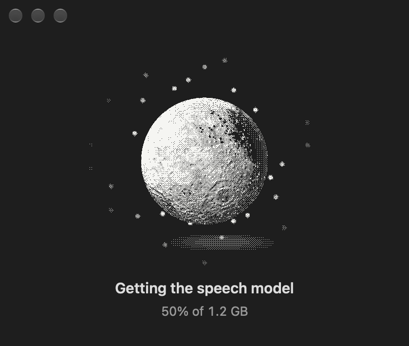
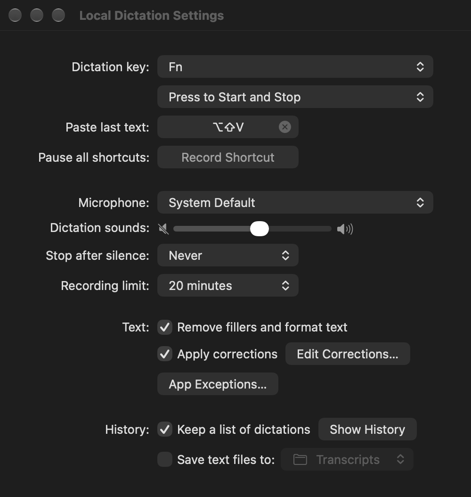

# Local Dictation

[](https://github.com/exgota/local-dictation/actions/workflows/continuous-integration.yml)

Free, open-source dictation for macOS, built for people who prompt AI tools by voice. Press Fn, talk, press Fn again,
and your words are typed where the cursor is. Speech is recognized on your Mac, with no account. English only.


## Install

You need a Mac with Apple silicon, macOS 27 or later, and about 2.5 GB of free space while the speech model installs. It
takes about 1.3 GB after that.

1. Download [`Local-Dictation.dmg`](https://github.com/exgota/local-dictation/releases/latest/download/Local-Dictation.dmg),
   open it, and drag Local Dictation onto the Applications folder in the window.
2. Open Local Dictation from Applications. The app is not notarized by Apple, so the first time macOS says it cannot
   verify the app. Click Done.
3. Open System Settings → Privacy & Security, scroll to Security, and click Open Anyway next to Local Dictation. Confirm
   with your password.

If you open the app from the disk image or from Downloads instead, it offers to move itself to Applications. Choose
Move to Applications, and it moves and reopens. `Local-Dictation.zip` on the same release holds the same app.

Setup then walks through four steps, one at a time:

1. **Microphone**, so it can hear you.
2. **Accessibility**, so it can notice the Fn key and type into other apps.
3. **The speech model**, a one-time download of about 1.2 GB from
   [Hugging Face](https://huggingface.co/ConwayResearch/Underdog-Bark-3.0-Pro). The download takes the percentage to
   80%. Then "Preparing for this Mac" takes it the rest of the way, which takes about a minute. "Ready, 100%" means you
   can start dictating. If the download stops, choose Try Again.
4. **Try it.** Press Fn, say something, and press Fn again. Your words appear in the setup window.



After setup the app lives in the menu bar as a waveform. Click it to start dictation, paste your last dictation, open
history, pause the shortcuts or open Settings. Paste last text has a shortcut too, Option-Shift-V (⌥⇧V) by default.

## Updates

The app checks GitHub for new versions on its own. When one is ready, you see an update alert, or an Install update…
item in the menu if the alert would have interrupted you. Nothing installs until you choose Install Update. Versions
before 1.1 cannot check, so install the latest version by hand once.

## How it works

- **Fn starts and stops a dictation.** Escape cancels the one in progress. Settings offers hold to talk and other keys.
- **You can start right after launch.** After setup, if the speech model is still loading when you press Fn, the app
  records anyway and types your words once the model is ready. If the model fails to load, or is still not ready two
  minutes after you start recording, a sound plays and the recording stays in memory until the model recovers, you
  cancel it or you quit.
- **The text is typed where you were working,** and your clipboard is put back the way it was.
- **When it cannot type,** because focus moved or there is no text field, the moon folds into a copy icon and the text
  goes on the clipboard: press ⌘V. The icon rises away after 5 seconds, or sooner if you paste. Your text stays on the
  clipboard until you copy something else. To get your last dictation back later, choose Paste last text from the menu.
  If the app could not confirm the text was typed, check before pasting, because it may already be there.
- **Cleanup depends on the app.** Most apps get the words as recognized. Slack, Discord, Telegram, WhatsApp and Messages
  get light cleanup: "um" and similar fillers go, "comma" and "new line" become punctuation, sentences are capitalized,
  and "scratch that" deletes the last sentence of the current dictation. Turn on Remove fillers and format text in
  Settings for the same cleanup in other apps, or set any app under App Exceptions. Terminals and code editors stay
  unformatted, and known password managers receive nothing, unless you change them there.
- **Corrections** are your own replacement rules for words it keeps getting wrong, for example "cloud code" to Claude
  Code. Turn on Apply corrections and choose Edit Corrections….
- **History and text files** are optional and off by default. History shows your dictations with Copy and Add
  Correction. Text files go in the Transcripts folder on your Desktop by default, in a folder for each day, as Markdown,
  a plain-text format.
- **The microphone is on only while you dictate.**
- **A lock on the menu bar icon** means another app, such as a password manager or Terminal's Secure Keyboard Entry, is
  protecting what you type, so Local Dictation cannot notice Fn. Hold the pointer over the icon to see which app it is,
  when the app can tell.



## Accuracy and speed

It uses Underdog Bark 3.0 Pro, a Parakeet speech model, running on the Mac with Core ML. In tests of version 1.0.1 on
one Mac, it measured a 0.8 to 2.1% word error rate on recorded test speech. It transcribes while you speak, so there is
little to wait for when you stop. [docs/SPEC.md](docs/SPEC.md) has the measurements and how they were taken.

## Privacy

Local Dictation recognizes speech on your Mac and does not upload your audio or text. The app does not save recordings.
Transcripts are saved only if you turn on history (kept in `~/Library/Application Support/LocalDictation/`) or text
files. Clearing history does not delete text files. Your last dictation stays in memory until a newer one with words
replaces it or you quit, so you can paste it again. Once text is typed or pasted into another app, that app decides what
happens to it.

The app goes online only to download the speech and voice activity models from Hugging Face, and to check GitHub for
updates and download them.

## Build from source

You need Xcode with the Swift 6.2 toolchain or later.

```sh
git clone https://github.com/exgota/local-dictation.git
cd local-dictation
./build_application.sh
```

The script builds, signs and installs the app to `~/Applications/Local Dictation.app`. It signs with a code-signing
identity named Local Dictation Development when your keychain has one. Without it the app is signed ad hoc, and macOS
asks for its permissions again after every rebuild. [BUILD.md](BUILD.md) shows how to create the identity, and covers
releases, tests and benchmarks. [docs/SPEC.md](docs/SPEC.md) covers the architecture, the model and the measurements.
[AGENTS.md](AGENTS.md) gives a reading order for reviewers.

## Licenses

The code is under the [MIT License](LICENSE). Underdog Bark 3.0 Pro and the models it derives from are CC BY 4.0. Silero
VAD is MIT, FluidAudio is Apache 2.0 and Sparkle is MIT. See [Packaging/NOTICE](Packaging/NOTICE).
