# Local Dictation: specification

Local Dictation is a macOS menu-bar app that turns speech into text and inserts the text where the cursor was. By
default the user presses the Fn (Function) key, speaks, and presses Fn again. Speech recognition runs on the Mac, on
Core ML (Apple's on-device machine-learning framework), with Underdog Bark 3.0 Pro, a derivative of the 0.6 billion
parameter model Parakeet TDT (token-and-duration transducer). After the one-time model download the app opens no
network connection.

Every measurement in this document was taken on one Mac, running macOS 27, on
October 26, 2026.

## Numbers

| What | Value | Source |
|---|---|---|
| Model files | 1,234,585,331 bytes, 15 files, pinned revision `4b5c51e` (one fixed commit of the model repository) | [model/model_manifest.json](model/model_manifest.json) |
| Compiled cache (the model components listed under Speech model, after compilation on this Mac) | Encoder 1.1 GB, Decoder 23 MB, Joint 12 MB, Preprocessor 1.2 MB | on disk after install |
| Model load at launch | 6.2 s; 38.8 s on the first load ever, while macOS compiles the model for the Neural Engine (the Mac's machine-learning accelerator) | [measurements/model-benchmark-run2.txt](measurements/model-benchmark-run2.txt), [measurements/model-benchmark-run1.txt](measurements/model-benchmark-run1.txt) |
| Transcription speed | 324 s of audio in 1.4 to 2.4 s on the Neural Engine. The real-time factor (RTF, processing time divided by audio duration) is 0.004 to 0.007 | [measurements/model-benchmark-run1.txt](measurements/model-benchmark-run1.txt), [measurements/model-benchmark-run2.txt](measurements/model-benchmark-run2.txt) |
| Encoder on the GPU instead | The first prediction takes 34 to 60 s, so the Neural Engine is the default | [measurements/model-benchmark-run1.txt](measurements/model-benchmark-run1.txt), [measurements/model-benchmark-gpu-resources.txt](measurements/model-benchmark-gpu-resources.txt) |
| Stop to text, live | 0.14 to 0.25 s from the stop press to the finished transcript, after idle gaps of 0, 30 and 90 s, because recording start warms the encoder (one prediction on silence). Without the warm-up: 0.9 s after 90 s idle | [measurements/live-scenarios.txt](measurements/live-scenarios.txt) |
| Transcript to text in the field | 0.03 s in TextEdit, 0.05 s in Chrome. The first dictation in a Chromium-based browser or Electron app after launch takes 0.6 s more, once | [measurements/insertion-timing.txt](measurements/insertion-timing.txt) |
| Word error rate (word-level edit distance divided by the number of reference words) | 0.58 % on a 5.5 min live recording played through a speaker into the microphone; 0.81 to 2.11 % on recordings fed to the streaming pipeline | [measurements/streaming-benchmark.txt](measurements/streaming-benchmark.txt) |
| Memory (physical footprint, the figure Activity Monitor shows) | 96 MB idle with the model loaded; 49 to 53 MB peak in the streaming benchmark for 3 and 16 minute inputs | [measurements/streaming-benchmark.txt](measurements/streaming-benchmark.txt) |
| Idle CPU | 0.0 % | [measurements/streaming-benchmark.txt](measurements/streaming-benchmark.txt) |
| Tests | 149 unit tests pass; self-test 11 of 12 synthetic fixtures | [measurements/selftest.txt](measurements/selftest.txt) |

## Architecture

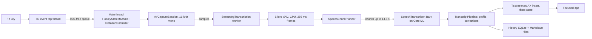

In the diagram, HID is the human interface device layer, where the system receives keyboard events. VAD is voice
activity detection, which rates each frame of audio as speech or not speech. AX is the macOS Accessibility interface.
Silero is the VAD model and Bark is the speech model.

| Module | Role | Main files |
|---|---|---|
| `DictationCore` | Pure logic with no AppKit dependency, unit tested | `HotkeyStateMachine.swift`, `EventTapSharedState.swift`, `TextInjection.swift`, `ClipboardPasteTransaction.swift`, `SpeechChunkPlanner.swift` |
| `DictationEngine` | Model download, validation, compilation, transcription, VAD, streaming | `ModelManifest.swift`, `ModelStore.swift`, `SpeechTranscriber.swift`, `StreamingTranscription.swift` |
| `TextProcessing` | Deterministic text cleanup and per-app profiles | `TranscriptProcessor.swift`, `VocabularyCorrections.swift`, `TranscriptProfile.swift` |
| `TranscriptHistory` | SQLite history | `TranscriptHistoryStore.swift` |
| `LocalDictation` | The app: controller, event tap, audio capture, text insertion, interface | `DictationController.swift`, `HotkeyEventTap.swift`, `AudioRecorder.swift`, `TextInserter.swift`, `SettingsWindow.swift`, `HeadsUpDisplay.swift` |

### Threads

| Thread | Work | Constraint |
|---|---|---|
| Hotkey event tap (own thread, own run loop) | Copies each key event into a ring buffer of 512 slots (511 events fit), decides from atomic variables whether to swallow the event, and signals the main run loop | The callback allocates nothing and takes no locks or I/O. macOS disables a tap that takes too long |
| Main | State machine, controller and interface | |
| `LocalDictation.AudioCapture` queue | `AVCaptureAudioDataOutput` delivers 16 kHz mono Float32 samples, which go to `StreamingTranscription` | A lock guards the consumer reference and is not held while the consumer runs |
| Streaming worker (detached task, user-initiated priority) | VAD for each 4096-sample frame, chunk planning, and transcription of each chunk while the user is still talking | A single consumer, so frames stay in order |
| Core ML | The encoder runs on the Neural Engine. The preprocessor, decoder, joint and VAD run on the CPU | |

## Lifecycle of one dictation

1. The user presses and releases Fn with no other key between the two events. In toggle mode, the default,
   `HotkeyStateMachine` then emits `toggle`. Hold modes are described under Hotkeys.
2. `DictationController` records the focused app and its focused Accessibility (AX) element, starts an
   `AVCaptureSession` (the AVFoundation capture session) and a `StreamingTranscription`, and shows the HUD (heads-up
   display). The start cue plays once the microphone delivers its first samples, so speech after the cue is never
   clipped. The microphone is on from this step until step 5.
3. The capture queue passes samples to the streaming worker, which cuts them into frames of 4096 samples (256 ms).
   Silero gives each frame a speech probability. `SpeechChunkPlanner` groups frames into chunks. It drops leading
   silence, and once a chunk holds 31 frames (about 8 s) it cuts at the next pause, which is a frame with a speech
   probability below 0.35. A chunk never exceeds 14.5 s: at 56 frames (14.3 s) the planner cuts at the least
   speech-like of the last 12 frames.
4. The worker transcribes each chunk as soon as it is cut. When transcription keeps pace with speech, only the last
   chunk remains to be transcribed when the user stops, even after a 10-minute dictation.
5. The user presses Fn again. Capture stops, the planner trims trailing silence from the last chunk, and the worker
   transcribes it. Recordings under 0.3 s are dropped without transcription, so a stray tap of Fn does nothing and Fn's
   own shortcuts keep working.
6. `TranscriptPipeline` applies the profile of the target app (see Text processing). `TextInserter` then checks that the
   same element still has focus and inserts the text.
7. The app writes the text to the history and to `~/Desktop/Transcripts/<date>/<time> <first words>.md`, each only when
   turned on. It writes after insertion, or after the fallback panel appears. A password-field refusal, a cancellation,
   the Suppressed profile and a recording cut short by a capture failure write nothing.

Fn pressed while an earlier dictation is still transcribing or inserting starts the next dictation at once. The press
is never ignored. Only one dictation records at a time. Earlier dictations keep transcribing and insert into their own
targets, and each waits for the dictation before it, so text arrives in the order it was spoken.

Escape cancels the recording if one is running. Otherwise it cancels every dictation that is still transcribing. Each
dictation has an identifier. A transcription that finishes after its dictation was cancelled never inserts.

## Speech model

The app uses Underdog Bark 3.0 Pro from the repository `ConwayResearch/Underdog-Bark-3.0-Pro`, revision
`4b5c51e04aa8d16dda9ecdff71bc29f7360149e4`. The installer checks every downloaded file against the size and SHA-256
digest in [model/model_manifest.json](model/model_manifest.json) before it compiles the model. The app drives the model
through [FluidAudio](https://github.com/FluidInference/FluidAudio), a Core ML wrapper library, at commit `a00964e`. It
follows the official runner shipped with the model.

The encoder is one Core ML model with two functions, `short8` and `full15`. Both take the same input and differ in
output length. The table lists the components in execution order.

| Component | Precision | Runs on | Inputs | Outputs |
|---|---|---|---|---|
| Preprocessor | Float32 | CPU | `audio_signal` [1, 240000] (up to 15 s), `audio_length` | `mel`, `mel_length` |
| Encoder, function `short8` | Float16 / Int32 | Neural Engine | `mel` [1, 128, 1501], `mel_length` | `encoder` [1, 1024, 101] |
| Encoder, function `full15` | Float16 / Int32 | Neural Engine | `mel` [1, 128, 1501], `mel_length` | `encoder` [1, 1024, 188] |
| Decoder (LSTM, 2 layers × 640) | Float16 | CPU | `targets` [1, 1], `h_in`, `c_in` [2, 1, 640] | `decoder` [1, 640, 1], `h_out`, `c_out` |
| JointDecisionv3 | Float16 | CPU | `encoder_step` [1, 1024, 1], `decoder_step` [1, 640, 1] | `token_id`, `token_prob`, `duration` |

`coremlcompiler` produced the full metadata in [model/](model/). The official runner that the app follows is in
[model/official-runner/](model/official-runner/).

- The app prepends 0.25 s of silence to every chunk, as the official runner does.
- `short8` takes audio of up to 8 s including that padding (128,000 samples). `full15` takes longer audio. A chunk never
  exceeds 14.5 s (the planner limit is 56 frames of 256 ms, which is 14.3 s), so `full15` always receives a single
  window.
- Decoding is greedy TDT (token and duration): no beam search, no vocabulary biasing, English only. Each chunk starts
  with a fresh decoder state.
- Both encoder functions load at launch. A warm-up is one prediction on silence, because the first prediction of a
  function is slower. The app warms the functions at launch with 1 s and 10 s of silence, so the first dictation pays no
  compile or warm-up cost. Each recording warms them again: `short8` when it starts and `full15` once it holds 5 s of
  audio.
- The compiled cache is in `~/Library/Application Support/LocalDictation/Models/<revision>/compiled/`. After
  compilation the app deletes the downloaded source packages and keeps the license, notice and vocabulary files.

Silero VAD comes from the repository `FluidInference/silero-vad-coreml`, revision `b419383`, under the MIT license. It
is a precompiled `.mlmodelc` (the compiled Core ML format) of about 1 MB, pinned by SHA-256 digest like the speech model
and downloaded with it.

## Hotkeys

- The hotkey listener is a `CGEventTap` at the HID level, created with `.defaultTap` so that it can swallow keys. A tap
  swallows a key when its callback drops the event, so no app receives it. The tap requires the Accessibility
  permission. It does not need Input Monitoring.
- The trigger is Fn, Right Option, Right Command, or any non-modifier key with an exact set of modifiers (the set can be
  empty). A key with an exact set of modifiers is a chord.
- A press counts only when it is clean: no other modifier is held when the trigger goes down, and no other key goes down
  before the trigger comes up. Shortcuts that combine the trigger with another key, such as Fn with an arrow key,
  therefore keep working.
- The app has three modes. Toggle, the default, starts or stops recording on each clean press. Hold records while the
  trigger is held. Hold-with-double-tap-to-lock behaves as hold and, after a quick double tap (each tap at most 0.3 s,
  with at most 0.35 s between them), keeps recording on until the next clean press.
- The tap swallows these keys: the trigger when it is an ordinary key, the re-paste chord (⌥⇧V by default), which
  inserts the last transcript again, the pause chord (unset by default), which turns the trigger and re-paste hotkeys
  off and on, and Escape while a dictation is active. It also swallows the autorepeats and key-ups of a swallowed
  key-down. Modifier changes always pass through.
- When macOS disables the tap, for a timeout or by user input, the callback re-enables it at once and the main thread
  logs the event.
- Secure Event Input is a macOS mode that an app enables to keep key events from other processes. While another app
  holds it, event taps receive no key events, so the hotkeys cannot work. The app polls for it every second and shows a
  banner that names the holding app.
- The app reinstalls the tap after the Mac wakes from sleep. It disables App Nap (the macOS feature that throttles idle
  apps) by starting an activity with the option `userInitiatedAllowingIdleSystemSleep`, which still lets the Mac sleep.

## Getting text in

`TextInserter` probes the focused AX element, and `InjectionPlanner` chooses the insertion methods from the result:

- Password fields (`AXSecureTextField`) are refused, and so is any element of an app that holds Secure Event Input. The
  fallback panel, a floating panel that shows the text with a Copy button, appears. The app does not place the text on
  the clipboard.
- No editable element: the fallback panel shows the text, and the text is also placed on the clipboard.
- `AXSelectedText` settable and the value readable: insert through Accessibility first, then paste.
- Otherwise: paste.

Each method returns one of three results:

- Delivered: the text demonstrably arrived.
- Not delivered: the text demonstrably did not arrive, because the field reads back unchanged.
- Uncertain: something was sent that may still arrive.

The chain moves to the next method only after "not delivered". After "uncertain" it stops and shows the fallback panel,
so the text is never inserted twice.

Accessibility insertion sets `AXSelectedText` and reads the field back for up to 0.5 s. Chromium-based browsers and
Electron apps accept the call without inserting, so their field reads back unchanged. The app remembers each application
where that happened and pastes first there for the rest of the session, which saves the 0.5 s read-back on every later
dictation. Each check reads the insertion
point and character count, and the full value only once one of them has changed, so a long document is not read in
full every 20 ms.

Paste writes the transcript to the clipboard as on-demand pasteboard data (`NSPasteboardItemDataProvider`), which calls
back into the app when a process reads it, and then posts Cmd-V. The read confirms the paste. macOS calls back only for
the first read and serves later reads from its own copy, so a clipboard manager that reads first hides the target's
read. The app therefore restores the user's previous clipboard once the field shows the text, or 1 s after the first
read where the field cannot be read, unless another process wrote to the clipboard in the meantime. If no process reads the data within 1.5 s, the Cmd-V may still be
handled late. The transcript then stays on the clipboard, never the previous contents, which a late paste would insert,
and the fallback panel shows it. The chain has no typing step, because after an unread paste, typing could insert the
text twice.

Before each method the app checks that the same app and the same AX element still have focus, comparing the elements
with `CFEqual`. If focus has moved, the fallback panel shows the text. No method starts while a different field has
focus.

## Text processing

Each step is optional and runs in this order:

1. Scratch that: the spoken command "scratch that" deletes everything from the start of its sentence through the
   command. When the command opens its own sentence, it deletes the previous sentence.
2. Spoken punctuation: words such as "period", "comma" and "new line" become symbols.
3. Filler removal: "um", "uh", "erm", "uhm" and "hmm" are removed, and so is "like" when it appears as ", like," or as
   "Like," at the start of a sentence.
4. Vocabulary corrections: listed mishearings are replaced with their canonical terms.
5. Capitalization: the first letter of the text and of each sentence becomes a capital. A word that already contains a
   capital stays as it is.
6. Final punctuation: a period is appended when the text ends with a letter or digit.

Whitespace is then normalized: runs of spaces collapse, and the ends are trimmed.

A profile sets which steps run for the app that receives the text. The app identifies that app by its bundle
identifier. Per-app overrides in the settings take precedence over this table.

| Profile | Apps | Steps |
|---|---|---|
| Verbatim (default) | everything not listed | vocabulary corrections only, and only when turned on |
| Chat | Slack, Discord, Messages, Telegram, WhatsApp | all steps (vocabulary corrections only when turned on); presses Return after inserting only when turned on |
| Code | Terminal, iTerm2, Warp, Ghostty, VS Code, Cursor, Zed, Xcode | as Verbatim; never presses Return |
| Suppressed | 1Password, Bitwarden, Passwords, Dashlane, LastPass, KeePassXC | nothing is inserted |

Vocabulary corrections are stored in `vocabulary.json`, shaped
`{"corrections": [{"canonical": "Claude Code", "mishearings": ["cloud code"]}]}`. Matching is case-insensitive, respects
word boundaries, and takes the longest match first. The app creates the file from its built-in list when the file does
not exist. A file that does not parse is left untouched, and the app uses the built-in list.

## Interface

Settings is a standard macOS preferences window with one tab per toolbar item. Each tab is a SwiftUI `Grid` sized to its
content, with no scroll view. Spacing comes from a scale of 4, 8, 12, 20 and 24 pt (`SettingsLayout`). The window uses
system fonts and colors, in Light and Dark appearance.

| | Light | Dark |
|---|---|---|
| General | 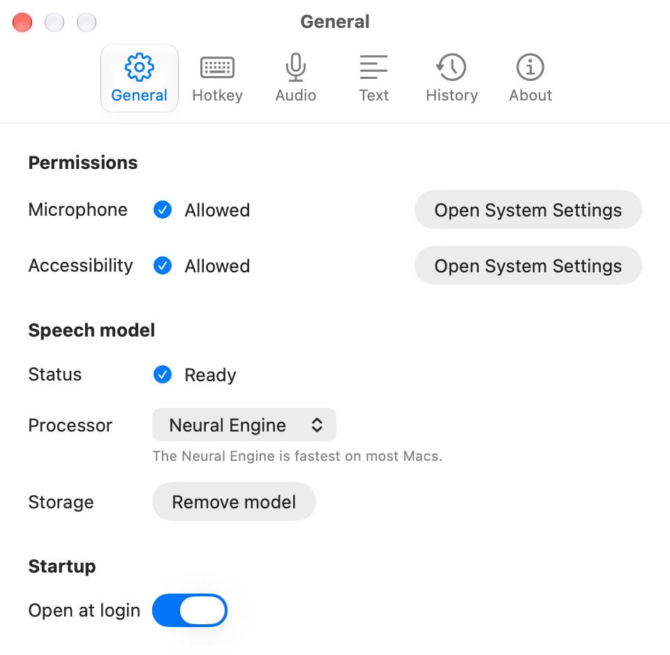 |  |
| Hotkey | 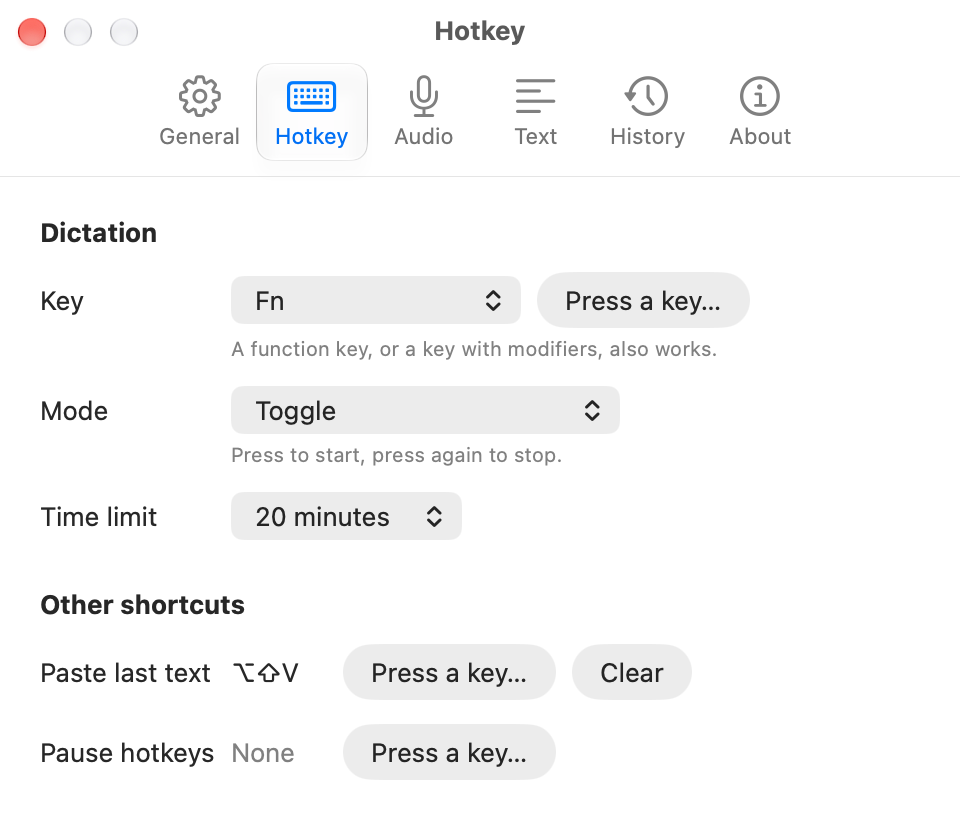 | 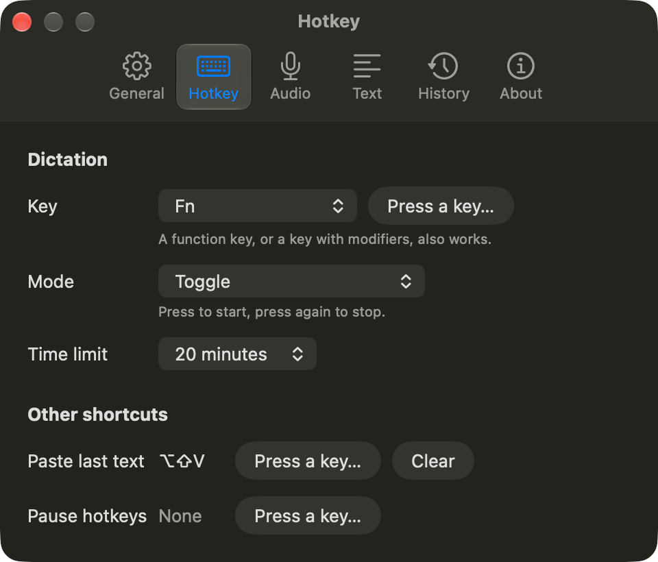 |
| Audio | 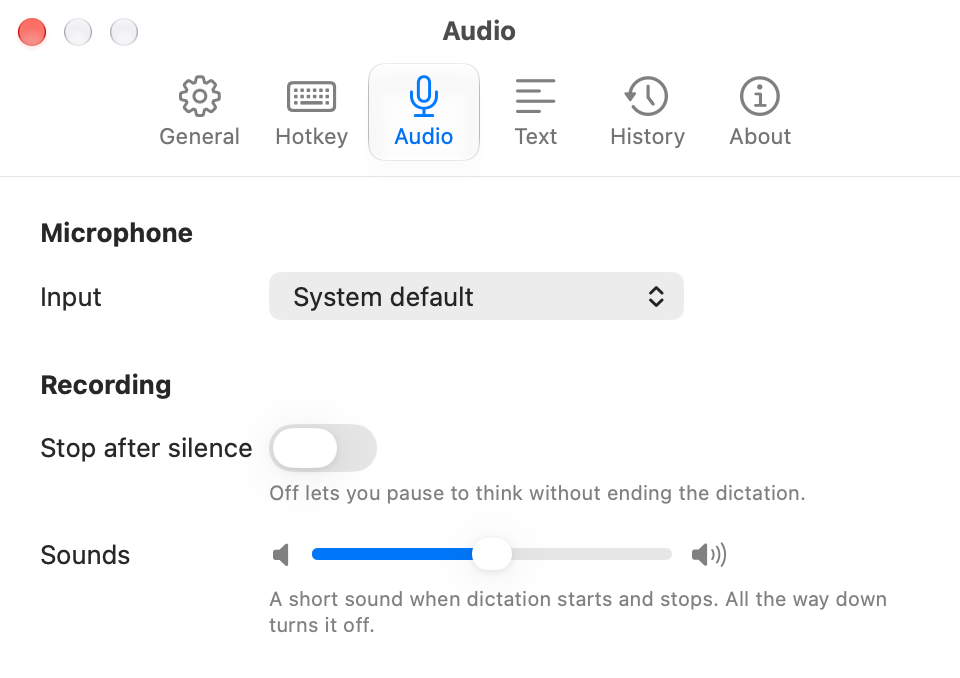 | 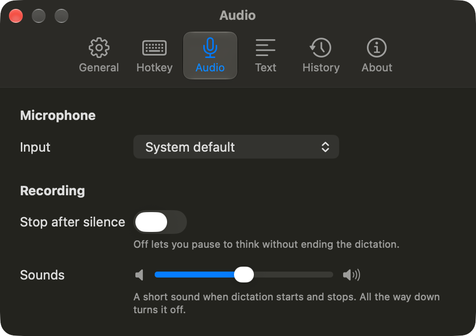 |
| Text | 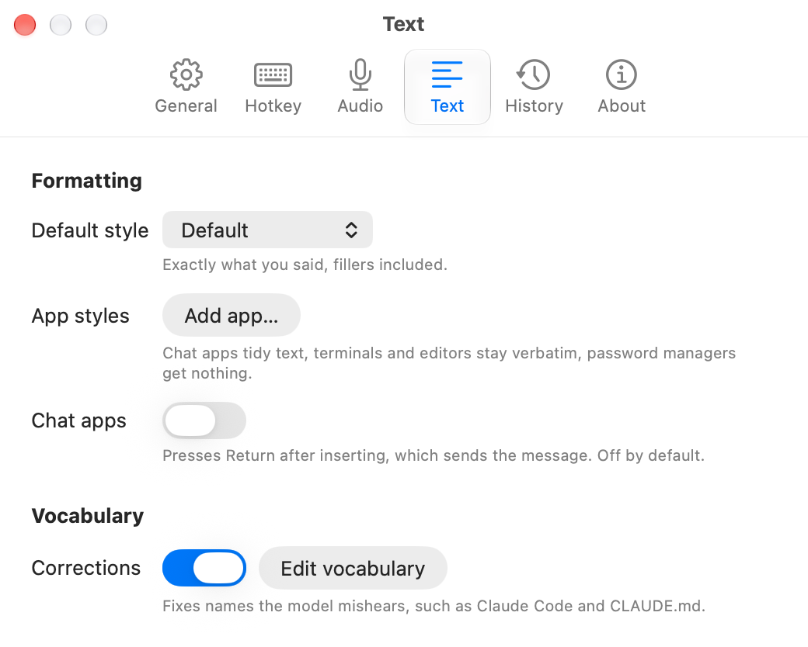 | 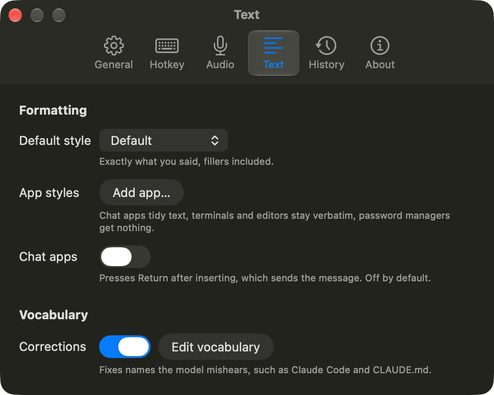 |
| History | 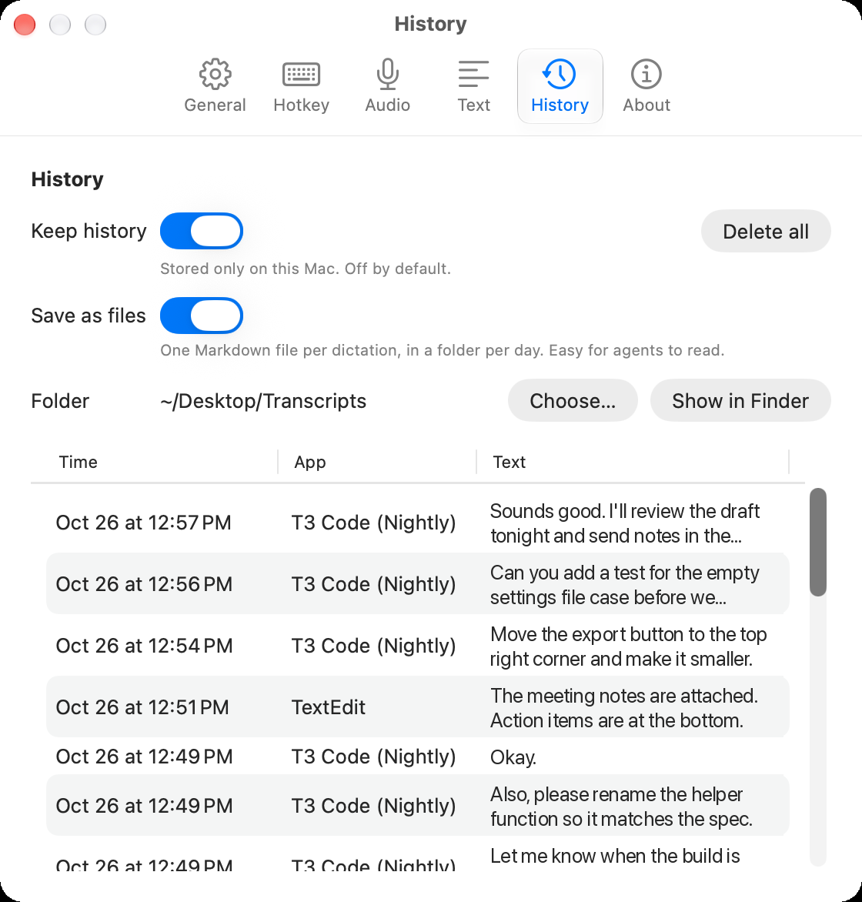 | 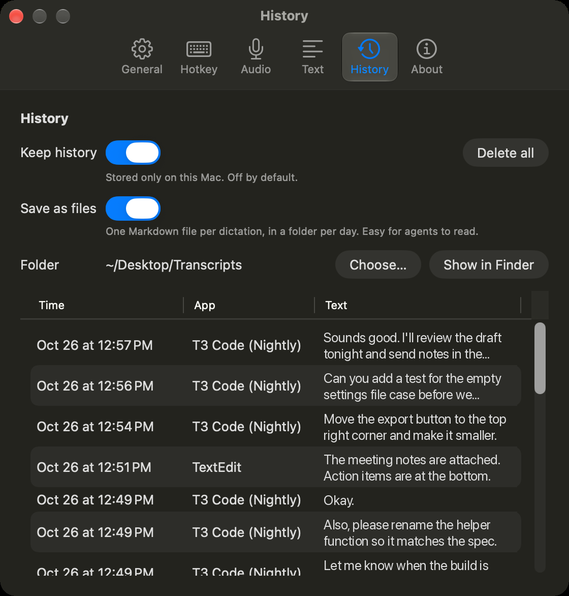 |
| About | 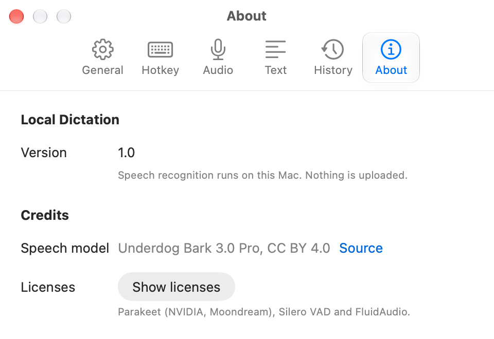 | 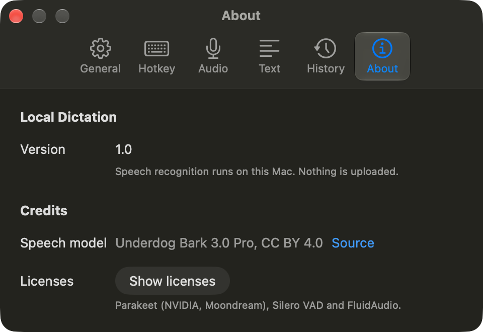 |
| Setup (first run) | 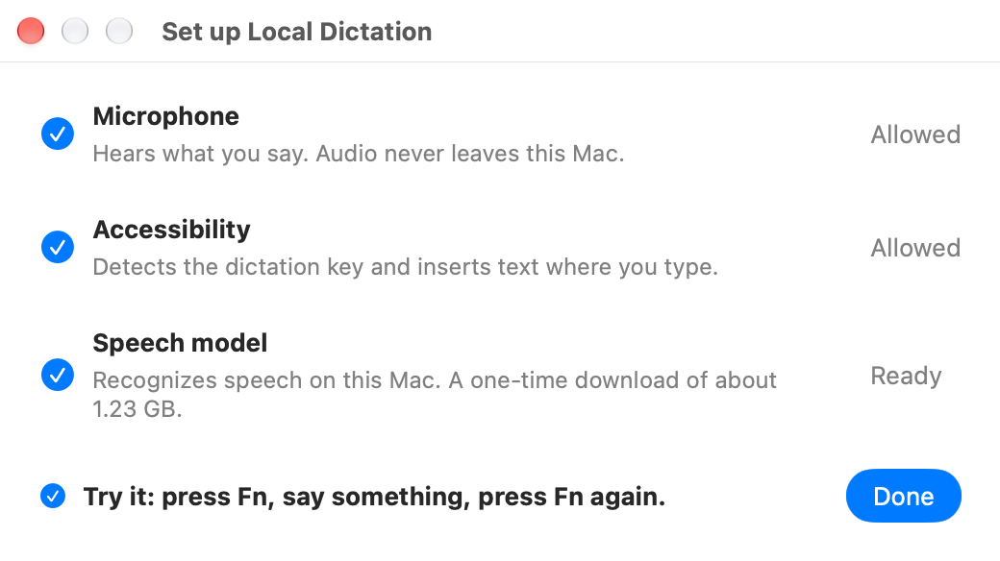 | 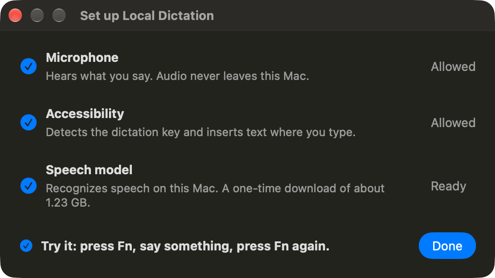 |
| HUD, listening (the same in Light and Dark) |  | |
| HUD, transcribing (the same in Light and Dark) | 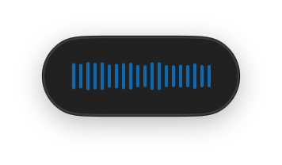 | |

The HUD is a dark pill of 124 × 50 pt in a non-activating panel, which is a window that does not make its app active.
The panel sits at the bottom of the screen that holds the mouse pointer and can never take focus.

While recording, the pill shows 20 bars that rise and fall in place with the voice. All bars follow one smoothed
loudness, and each bar scales it by a fixed offset. The smoothing takes about 60 ms to rise and 90 ms to fall. Below
-50 dBFS (decibels relative to full scale), which the app treats as room noise, the bars stay still. When recording
stops, the bars freeze where they are and dim until the text lands. The pill then disappears without waiting for the
clipboard restore. It scales and fades in over 150 ms and out over 120 ms.

The pill shows no text except "Model loading…", which appears when the trigger is pressed before the model is ready. The
menu bar icon does not change while dictating; it changes only when setup is needed. The start and stop sounds are
synthesised cues bundled with the app, played at an adjustable volume. See [audio/](audio/).

## Files and command line

| Path | Contents |
|---|---|
| `~/Library/Application Support/LocalDictation/settings.json` | All settings; hand edits apply while the app runs |
| `~/Library/Application Support/LocalDictation/vocabulary.json` | Vocabulary corrections |
| `~/Library/Application Support/LocalDictation/history.sqlite` | History, off until turned on |
| `~/Desktop/Transcripts/` | Markdown transcripts, off until turned on |
| `~/Library/Logs/LocalDictation/` | Event log (never transcript text), crash reports |

The executable `Local Dictation.app/Contents/MacOS/LocalDictation` accepts these flags:

- `--doctor` prints a diagnostic report on permissions, the Fn key mapping, Secure Event Input, the microphone, the
  model cache, event tap health and recent errors. Sample output: [measurements/doctor.txt](measurements/doctor.txt).
- `--selftest [DIR]` runs the fixtures in DIR (default: `~/Library/Application Support/LocalDictation/Fixtures`)
  through the real pipeline.
- `--toggle-transcription` starts or stops dictation in the running app.
- `--cancel` cancels dictation in the running app.
- `--bundle-logs` writes a zip of logs, crash reports and the `--doctor` output.

`--toggle-transcription`, `--cancel`, the report requests of `--doctor` and `--bundle-logs`, and the handoff from a
second launch reach the running app over a Unix socket in the per-user temporary folder (owner-only). `--selftest` does
not use the socket. The app accepts a command only from a process that runs as the same user and satisfies the app's own
code-signing requirement, which the app reads from the connection's audit token. No other process can start a recording
or read the report through the socket.

## Testing

- `swift test` runs 155 unit tests. They cover the hotkey state machine driven by synthetic key events, the clipboard
  transaction against a slow fake target, the injection chain with a spy, chunk boundaries from voice activity, the text
  steps, corrections, profiles, the cleanup client against a stubbed server, and history.
- `--selftest` runs WAV fixtures through the real pipeline and checks three things. The word error rate must be at most
  8 % for quiet fixtures and 15 % for noise and headset fixtures. Behavior fixtures must match the expected text word
  for word, ignoring case and punctuation. Latency, from the end of the audio to the final text, must be at most 1.5 s
  for audio up to 30 s.
- The repository's fixtures are synthetic. `Tests/fixtures/synthetic/generate_synthetic_fixtures.py` generates them
  with the macOS `say` command. The repository holds their expected transcripts but not their WAV files. The self-test
  marks their results @weak, because generated speech does not show how accurate the model is on a real voice.
- `Tests/EndToEnd/run_scenarios.sh` plays speech from the speakers into the microphone and drives the installed app with
  synthetic key events. Results: [measurements/live-scenarios.txt](measurements/live-scenarios.txt).

## Known limits

- The model transcribes English only and returns verbatim text, which keeps fillers unless a profile removes them. It
  sometimes ends a phrase with a period in the middle of a sentence.
- The one self-test fixture that fails (`01-quiet-short`) shows a real model error on synthetic speech: "fixed" for
  "fix".
- Chrome and Electron apps build their accessibility tree only when an assistive client asks. The app asks when the
  trigger is pressed and, if it finds no focused element, again every 250 ms for 3 s. That covers later dictations. The
  first dictation after Chrome itself launches can still end in the fallback panel, with the text on the clipboard.
- Not yet tested: Bluetooth microphones, the 20-minute recording limit, recovery after sleep, and the resumable model
  download (testing it needs a 1.2 GB re-download).

## Open questions for review

These are leads, not findings.

1. The preprocessor input is fixed at 240,000 samples and both encoder functions take 1,501 mel frames (columns of the
   mel spectrogram), so a 2 s chunk may pay for 15 s of mel and encoder work. Does FluidAudio pad every call to the full
   window? `short8` and `full15` differ only in output length.
2. The decoder and joint run once per emitted token on the CPU with Float16 weights. Would fusing them, or running them
   on the Neural Engine or GPU, cut the per-chunk tail?
3. Every chunk starts with a fresh decoder state. Carrying the LSTM state across chunk cuts might improve accuracy at
   the boundaries.
4. The 1.1 GB encoder costs 6 s to load at every launch, and 39 s the first time. Is there a cheaper warm path?
5. Would fine-tuning for one voice pay off, and what data would it
   need?
6. Which local model suits the optional cleanup pass? Dictated text contains recognition errors, and the cleanup has to
   keep the speaker's intent.
7. Interface: which elements in the screenshots could be simpler.
