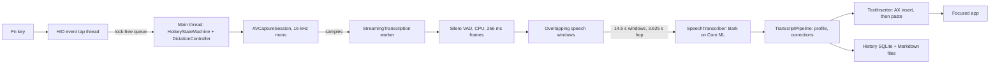
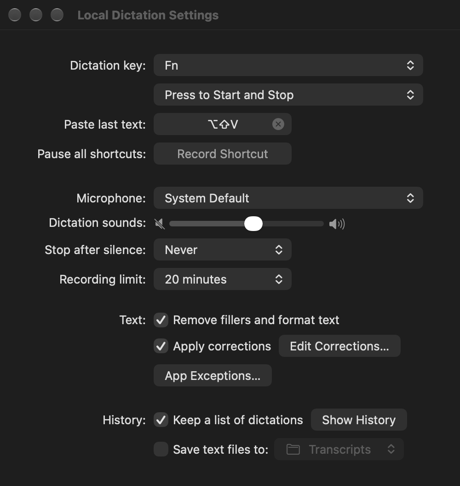
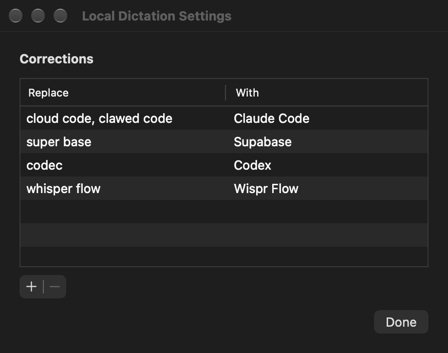
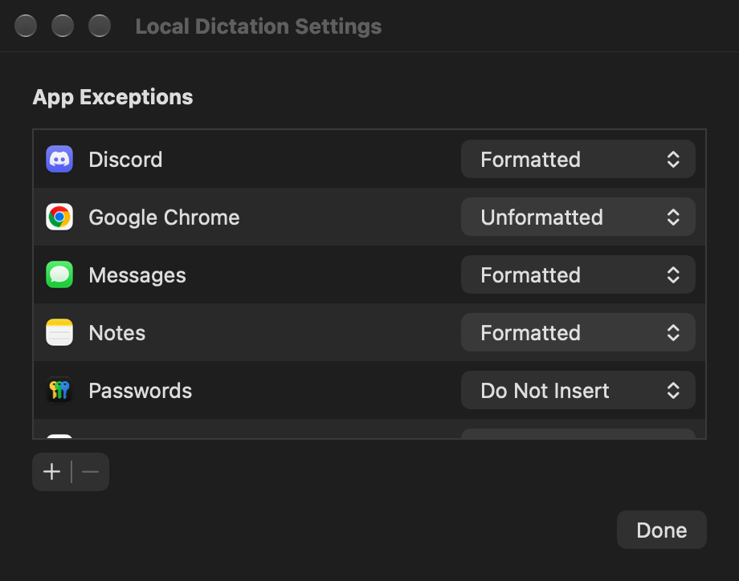
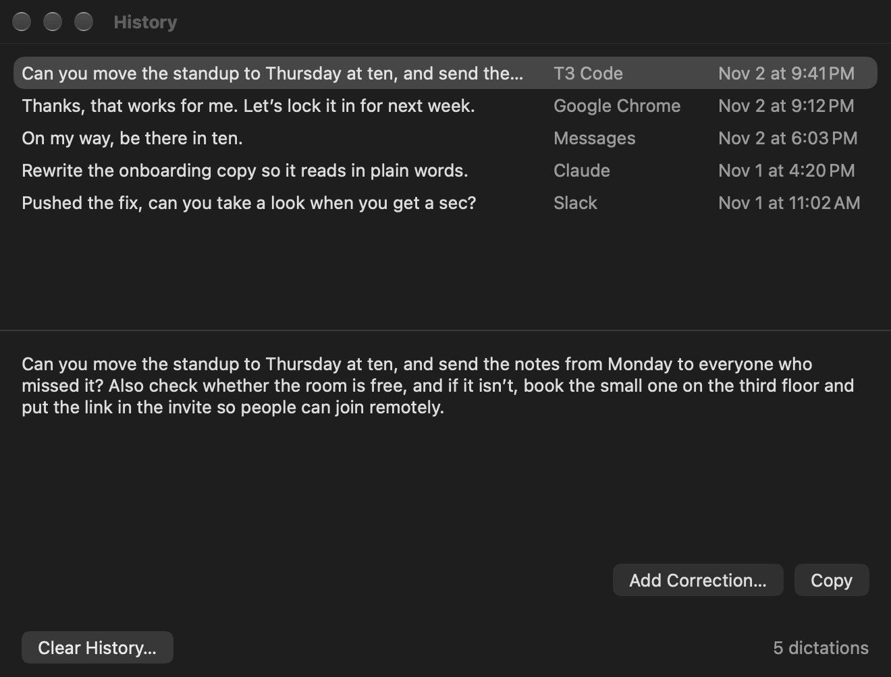

# Local Dictation: specification

Local Dictation 1.1.1 requires macOS 27 or later on Apple Silicon. It is a menu-bar app that turns speech into text and
inserts the text where the cursor was. By default the user presses the Fn (Function) key, speaks, and presses Fn again. Speech recognition runs on the Mac, on
Core ML (Apple's on-device machine-learning framework), with Underdog Bark 3.0 Pro, a derivative of the 0.6 billion
parameter model Parakeet TDT (token-and-duration transducer). Speech and audio remain local. Network access downloads the models and checks for and downloads app updates from GitHub.

The measurements in the table below describe the 1.0.1 release on one Mac running macOS 27 on October 26, 2026.
They do not measure the overlapping-window implementation.

## Numbers

| What | Value | Source |
|---|---|---|
| Model files | 1,234,585,331 bytes, 15 files, pinned revision `4b5c51e` (one fixed commit of the model repository) | [model/model_manifest.json](model/model_manifest.json) |
| Compiled cache (the model components listed under Speech model, after compilation on this Mac) | Encoder 1.1 GB, Decoder 23 MB, Joint 12 MB, Preprocessor 1.2 MB | on disk after install |
| Model load at launch | 6.2 s; 38.8 s on the first load ever, while macOS compiles the model for the Neural Engine (the Mac's machine-learning accelerator) | [measurements/model-benchmark-run2.txt](measurements/model-benchmark-run2.txt), [measurements/model-benchmark-run1.txt](measurements/model-benchmark-run1.txt) |
| Transcription speed | 324 s of audio in 1.4 to 2.4 s on the Neural Engine. The real-time factor (RTF, processing time divided by audio duration) is 0.004 to 0.007 | [measurements/model-benchmark-run1.txt](measurements/model-benchmark-run1.txt), [measurements/model-benchmark-run2.txt](measurements/model-benchmark-run2.txt) |
| Encoder on the GPU instead | The first prediction takes 34 to 60 s, so the Neural Engine is the default | [measurements/model-benchmark-run1.txt](measurements/model-benchmark-run1.txt), [measurements/model-benchmark-gpu-resources.txt](measurements/model-benchmark-gpu-resources.txt) |
| Stop to text, live | 0.14 to 0.25 s from the stop press to the finished transcript, after idle gaps of 0, 30 and 90 s, because recording start warms the encoder (one prediction on silence). Without the warm-up: 0.9 s after 90 s idle | [measurements/live-scenarios.txt](measurements/live-scenarios.txt) |
| Transcript to text in the field | 0.03 s in TextEdit, 0.05 s in Chrome. The first dictation in a Chromium-based browser or Electron app after launch takes 0.6 s more, once | [measurements/insertion-timing.txt](measurements/insertion-timing.txt) |
| Word error rate (word-level edit distance divided by the number of reference words) | 0.58 % on a 5.5 min live recording played through a speaker into the microphone; 0.81 to 2.11 % on recordings fed to the streaming pipeline | [measurements/streaming-benchmark.txt](measurements/streaming-benchmark.txt) |
| Memory (physical footprint, the figure Activity Monitor shows) | 96 MB idle with the model loaded; 49 to 53 MB peak in the streaming benchmark for 3 and 16 minute inputs | [measurements/streaming-benchmark.txt](measurements/streaming-benchmark.txt) |
| Idle CPU | 0.0 % | [measurements/streaming-benchmark.txt](measurements/streaming-benchmark.txt) |
| Tests | 165 unit tests pass; self-test 11 of 12 synthetic fixtures | [measurements/selftest.txt](measurements/selftest.txt) |

## Architecture

In the diagram, HID is the human interface device layer, where the system receives keyboard events. VAD is voice
activity detection, which rates each frame of audio as speech or not speech. AX is the macOS Accessibility interface.
Silero is the VAD model and Bark is the speech model.

| Module | Role | Main files |
|---|---|---|
| `DictationCore` | Pure logic with no AppKit dependency, unit tested | `HotkeyStateMachine.swift`, `EventTapSharedState.swift`, `TextInjection.swift`, `ClipboardPasteTransaction.swift`, `MicrophoneSilenceMonitor.swift`, `SpeechWindowBuffer.swift`, `TranscriptOverlapMerger.swift` |
| `DictationEngine` | Model download, validation, compilation, transcription, VAD, streaming | `ModelManifest.swift`, `ModelStore.swift`, `SpeechTranscriber.swift`, `StreamingTranscription.swift` |
| `TextProcessing` | Deterministic text cleanup and per-app profiles | `TranscriptProcessor.swift`, `VocabularyCorrections.swift`, `TranscriptProfile.swift` |
| `TranscriptHistory` | SQLite history | `TranscriptHistoryStore.swift` |
| `MoonRendering` | Shared Metal drawing, surface maps, native canvas and deterministic offscreen captures | `MoonRenderer.swift`, `MoonCanvasView.swift`, `Moon.metal` |
| `LocalDictation` | The app: controller, event tap, audio capture, text insertion, interface | `Session/DictationController.swift`, `Hotkeys/HotkeyEventTap.swift`, `Recording/AudioRecorder.swift`, `Insertion/TextInserter.swift`, `Settings/SettingsWindow.swift`, `Display/HeadsUpDisplay.swift` |

### Threads

| Thread | Work | Constraint |
|---|---|---|
| Hotkey event tap (own thread, own run loop) | Copies each key event into a ring buffer of 512 slots (511 events fit), decides from atomic variables whether to swallow the event, and signals the main run loop | The callback allocates nothing and takes no locks or I/O. macOS disables a tap that takes too long |
| Main | State machine, controller and interface | |
| `LocalDictation.AudioCapture` queue | `AVCaptureAudioDataOutput` delivers 16 kHz mono Float32 samples, which go to `StreamingTranscription` | A lock guards the consumer reference and is not held while the consumer runs |
| Streaming worker (detached task, user-initiated priority) | VAD for each 4096-sample frame and transcription of each overlapping window while the user is still talking | A single consumer, so frames stay in order |
| Core ML | The encoder runs on the Neural Engine. The preprocessor, decoder, joint and VAD run on the CPU | |

## Lifecycle of one dictation

1. The user presses and releases Fn with no other key between the two events. In toggle mode, the default,
   `HotkeyStateMachine` then emits `toggle`. Hold modes are described under Hotkeys.
2. `DictationController` records the focused app and its focused Accessibility (AX) element, starts an
   `AVCaptureSession` (the AVFoundation capture session), and shows the HUD (heads-up display). A `RecordingTranscription`
   starts `StreamingTranscription` immediately when the model is ready. During loading it accepts audio into memory
   first, then hands the buffered and live samples to the same streaming worker in capture order. The start cue plays once the microphone delivers its first samples, so speech after the cue is never
   clipped. The microphone is on from this step until step 5.
3. The capture queue passes samples to the streaming worker, which evaluates 4096-sample (256 ms) frames with
   Silero. Speech starts at probability 0.5. After speech, the worker uses a 0.35 continuation threshold while no
   more than three preceding frames have been classified as nonspeech, then returns to 0.5. The detector reports trailing silence for the optional auto-stop. The worker keeps 512 ms before and 768 ms after
   detected speech when it trims an analysis window. Windows with no detected speech are skipped.
4. The worker transcribes 14.5 s windows every 3.625 s, keeping the overlap in memory. It joins successive results at
   matching, similarly timed words near the middle of their overlap. A recording no longer than one window needs one
   decode. When timings are missing, empty, nonmonotonic or inconsistent with the model text, the worker keeps the existing result, decodes only audio not
   already covered, and starts a fresh window. The literal unknown-token marker is removed without guessing punctuation.
5. The user presses Fn again. Capture stops and, if audio extends beyond the last full window, the worker decodes at
   most one remaining window, plus a short fallback decode if timings are unusable. Recordings under 0.3 s are dropped
   without transcription, so a stray tap of Fn does nothing and Fn's own shortcuts keep working. The capture stream
   retains pending samples until the worker consumes them. It does not impose a fixed queue limit; the app's recording
   duration setting limits a session to at most 60 minutes.
6. `TranscriptPipeline` applies the profile of the target app (see Text processing). `TextInserter` then checks that the
   same element still has focus and inserts the text.
7. The app writes the text to the history and to `~/Desktop/Transcripts/<date>/<time> <first words>.md`, each only when
   turned on. It writes after insertion, or after the parked moon appears. A password-field refusal, a cancellation,
   the Suppressed profile and a recording cut short by a capture failure write nothing.

Fn pressed while an earlier dictation is still transcribing or inserting starts the next dictation at once. The press
is never ignored. Only one dictation records at a time. Earlier dictations keep transcribing and insert into their own
targets, and each waits for the dictation before it, so text arrives in the order it was spoken.

Recording does not wait for an installed model to finish loading. Buffered audio uses the existing recording limit,
with a sample-count cap as well as the recorder's duration timer. At 16 kHz Float32, the maximum 60-minute setting
holds at most 230,400,000 sample bytes per recording, excluding container overhead. Audio never reaches disk.
When the model becomes ready before stop, transcription catches up while capture continues. When stop comes first,
the completed recording waits, with the transcribing moon visible, and then uses the same focused-field validation,
text processing, insertion and Park paths as any other dictation.

A model load failure or 120-second wait from recording start ends the active wait and plays the existing failure
sound. Capture already in progress continues within its original limit. A stopped recording waits at most 120 seconds
for transcription; the watchdog then cancels it and shows Park with a logged timeout, without copying text it does
not have. No transcript can be recovered until a model is available. If the model recovers before that deadline,
these recordings retain their delivery order and use Park instead of automatic insertion. Recovery respects
suppressed profiles and secure fields. It copies only if the clipboard has not changed since stop; otherwise Paste
last text retains the result. Escape cancels retained recordings under the same rule as pending transcriptions.
Sleep ends capture, microphone interruption preserves the partial recording for Park, and another trigger press while
waiting starts a new recording without replacing the earlier one. Silence auto-stop starts evaluating speech once the
model is ready; the recording limit and Escape work throughout loading.

Every stopped delivery records exactly one terminal outcome: insertion, Park with its reason, or refusal. Empty
recognition, suppression, secure fields, cancellation and errors are logged refusals. A transcript has ten seconds
from recognition to delivery, including any wait for an earlier delivery. Expiry parks the text with a timeout
reason, preserves newer clipboard contents, and prevents the worker from later starting another insertion. Ordering
waits for the preceding delivery's terminal outcome, not its worker task or history write. Successful insertion into
setup's field is logged through the same boundary. Setup never receives a dictation captured for another application.

Paste last text works during other recording or transcription work. The last usable transcript stays in memory until
a newer usable result replaces it or the app exits; short, empty, suppressed and cancelled recordings do not erase it.
Missing text or a missing target is logged. Without a focused application, the command copies the text for recovery.

Escape cancels the recording if one is running. Otherwise it cancels every dictation that is still transcribing. Each
dictation has an identifier. A transcription that finishes after its dictation was cancelled never inserts.

## Speech model

The app uses Underdog Bark 3.0 Pro from the repository `ConwayResearch/Underdog-Bark-3.0-Pro`, revision
`4b5c51e04aa8d16dda9ecdff71bc29f7360149e4`. The installer checks every downloaded file against the size and SHA-256
digest in [model/model_manifest.json](model/model_manifest.json) before it compiles the model. The app drives the model
through [FluidAudio](https://github.com/FluidInference/FluidAudio), a Core ML wrapper library, at commit `a00964e`. It
follows the official runner shipped with the model.

The encoder is one Core ML model with two functions, `short8` and `full15`. Both take the same input and differ in
output length. The table lists the components in execution order.

| Component | Precision | Runs on | Inputs | Outputs |
|---|---|---|---|---|
| Preprocessor | Float32 | CPU | `audio_signal` [1, 240000] (up to 15 s), `audio_length` | `mel`, `mel_length` |
| Encoder, function `short8` | Float16 / Int32 | Neural Engine | `mel` [1, 128, 1501], `mel_length` | `encoder` [1, 1024, 101] |
| Encoder, function `full15` | Float16 / Int32 | Neural Engine | `mel` [1, 128, 1501], `mel_length` | `encoder` [1, 1024, 188] |
| Decoder (LSTM, 2 layers × 640) | Float16 | CPU | `targets` [1, 1], `h_in`, `c_in` [2, 1, 640] | `decoder` [1, 640, 1], `h_out`, `c_out` |
| JointDecisionv3 | Float16 | CPU | `encoder_step` [1, 1024, 1], `decoder_step` [1, 640, 1] | `token_id`, `token_prob`, `duration` |

`coremlcompiler` produced the full metadata in [model/](model/). The official runner that the app follows is in
[model/official-runner/](model/official-runner/).

- The app prepends 0.25 s of silence to every window, as the official runner does.
- `short8` takes audio of up to 8 s including that padding (128,000 samples). `full15` takes longer audio. A 14.5 s
  window and the leading silence total 14.75 s, so `full15` receives a single window.
- Decoding is greedy TDT (token and duration): no beam search, no vocabulary biasing, English only. Each window starts
  with a fresh decoder state.
- Both encoder functions load at launch. A warm-up is one prediction on silence, because the first prediction of a
  function is slower. The app warms the functions at launch with 1 s and 10 s of silence, so the first dictation pays no
  compile or warm-up cost. Each recording warms them again: `short8` when it starts and `full15` once it holds 5 s of
  audio.
- The compiled cache is in `~/Library/Application Support/LocalDictation/Models/<revision>/compiled/`. After
  compilation the app deletes the downloaded source packages and keeps the license, notice and vocabulary files.

Silero VAD comes from the repository `FluidInference/silero-vad-coreml`, revision `b419383`, under the MIT license. It
is a precompiled `.mlmodelc` (the compiled Core ML format) of about 1 MB, pinned by SHA-256 digest like the speech model
and downloaded with it.

## Hotkeys

- The hotkey listener is a `CGEventTap` at the HID level, created with `.defaultTap` so that it can swallow keys. A tap
  swallows a key when its callback drops the event, so no app receives it. The tap requires the Accessibility
  permission. It does not need Input Monitoring.
- The trigger is Fn, Right Option, Right Command, or any non-modifier key with an exact set of modifiers (the set can be
  empty). A key with an exact set of modifiers is a chord.
- A press counts only when it is clean: no other modifier is held when the trigger goes down, and no other key goes down
  before the trigger comes up. Shortcuts that combine the trigger with another key, such as Fn with an arrow key,
  therefore keep working.
- The app has three modes. Toggle, the default, starts or stops recording on each clean press. Hold records while the
  trigger is held. Hold-with-double-tap-to-lock behaves as hold and, after a quick double tap (each tap at most 0.3 s,
  with at most 0.35 s between them), keeps recording on until the next clean press.
- The tap swallows these keys: the trigger when it is an ordinary key, the re-paste chord (⌥⇧V by default), which
  inserts the last transcript again, the pause chord (unset by default), which turns the trigger and re-paste hotkeys
  off and on, and Escape while a dictation is active. It also swallows the autorepeats and key-ups of a swallowed
  key-down. Modifier changes always pass through.
- When macOS disables the tap, for a timeout or by user input, the callback re-enables it at once and the main thread
  logs the event.
- Secure Event Input is a macOS mode that an app enables to keep key events from other processes. While another app
  holds it, event taps receive no key events, so the hotkeys cannot work. The app polls for it every second, including
  while the menu is open, and adds a lock badge to the waveform menu-bar icon. The menu says “Shortcuts blocked” and
  names the application using secure input. Attribution first checks `kCGSSessionSecureInputPID` in
  `CGSessionCopyCurrentDictionary()`, then the current user's on-console entry in `IOConsoleUsers` at the I/O Registry
  root. The IOService plane entry does not expose these sessions on the release-check Mac. The PID key is not a
  guaranteed public API: when macOS omits it or the process name is unavailable, the app keeps “Another app” rather
  than guessing from the frontmost app. Terminal's Secure Keyboard Entry attribution still needs a desktop check.
  No on-screen notice appears.
- The app reinstalls the tap after the Mac wakes from sleep. It disables App Nap (the macOS feature that throttles idle
  apps) by starting an activity with the option `userInitiatedAllowingIdleSystemSleep`, which still lets the Mac sleep.

## Getting text in

`TextInserter` probes the focused AX element, and `InjectionPlanner` chooses the insertion methods from the result:

- Password fields (`AXSecureTextField`) are refused, and so is any element of an app that holds Secure Event Input. The
  moon fades out in place. The app does not copy or keep the text.
- No editable element: Park shows the copy mark if text was copied. The text is placed on the clipboard only if it
  has not changed since recording stopped.
- `AXSelectedText` settable and the value readable: insert through Accessibility first, then paste.
- Otherwise: paste.

Each method returns one of three results:

- Delivered: the text demonstrably arrived.
- Not delivered: the text demonstrably did not arrive, because the field reads back unchanged.
- Uncertain: something was sent that may still arrive.

The chain moves to the next method only after "not delivered". After "uncertain" it stops and shows the parked moon,
so the text is never inserted twice.

Accessibility insertion sets `AXSelectedText` and reads the field back for up to 0.5 s. Chromium-based browsers and
Electron apps accept the call without inserting, so their field reads back unchanged. The app remembers each application
where that happened and pastes first there for the rest of the session, which saves the 0.5 s read-back on every later
dictation. Each check reads the insertion
point and character count, and the full value only once one of them has changed, so a long document is not read in
full every 20 ms.

Stopping capture records the pasteboard change count before stopping the recorder. Every automatic clipboard write,
including no-field and focus-moved misses, Accessibility fallback, model or microphone recovery, delivery timeout and
paste insertion, uses that boundary. A newer copy is preserved and Park uses the newer-clipboard reason and VoiceOver
announcement, with no copy glyph. The transcript remains available through Paste last text. Explicit Paste last text
starts a new boundary at that command, so it can recover text without overwriting a copy made while recovery is pending.
Paste rechecks the count after snapshotting promised data, immediately before writing. Restoration and conversion from
on-demand to plain text require the transaction's own change count to remain current.

Paste writes the transcript to the clipboard as on-demand pasteboard data (`NSPasteboardItemDataProvider`), which calls
back into the app when a process reads it, and then posts Cmd-V. If the write fails, the app posts no shortcut and
restores the previous contents if it still owns the clipboard. The read confirms the paste. macOS calls back only for
the first read and serves later reads from its own copy, so a clipboard manager that reads first hides the target's
read. The app therefore restores the user's previous clipboard once the field shows the text, or 1 s after the first
read where the field cannot be read, unless another process wrote to the clipboard in the meantime. If no process reads the data within 1.5 s, the Cmd-V may still be
handled late. The transcript then stays on the clipboard, never the previous contents, which a late paste would insert,
and Park shows the copy mark. The chain has no typing step, because after an unread paste, typing could insert the
text twice.

Before each method the app resolves the currently focused element against the recording-time target. The same
frontmost process and `CFEqual` element identity remain the fast path, with a window mismatch rejected. A replacement
object requires the same window and immediate parent by `CFEqual`, identical role, subrole, AX identifier, DOM
identifier, placeholder, frame and sibling index, and at least one nonempty identifier or placeholder. Its fingerprint
must be unique among the parent's children (bounded to 256). Missing or ambiguous evidence refuses insertion.
Snapshots exclude text and selection. The current matched object is used for insertion and read-back, and secure or
noneditable replacements are refused before each attempt. Parent recreation, layout changes and unnamed fields can
still cause conservative fallback. Replacement during an unconfirmed Accessibility attempt cannot prove non-delivery
from the stale object's unchanged value, so it stops as uncertain without a paste retry. The parked moon offers recovery without displaying transcript text.

## Text processing

Each step is optional and runs in this order:

1. Scratch that: the spoken command "scratch that" deletes everything from the start of its sentence through the
   command. When the command opens its own sentence, it deletes the previous sentence.
2. Spoken punctuation: words such as "period", "comma" and "new line" become symbols.
3. Filler removal: "um", "uh", "erm", "uhm" and "hmm" are removed, and so is "like" when it appears as ", like," or as
   "Like," at the start of a sentence.
4. Vocabulary corrections: listed mishearings are replaced with their canonical terms.
5. Capitalization: the first letter of the text and of each sentence becomes a capital. A word that already contains a
   capital stays as it is.
6. Final punctuation: a period is appended when the text ends with a letter or digit.

Whitespace is then normalized: runs of spaces collapse, and the ends are trimmed.

A profile sets which steps run for the app that receives the text. The app identifies that app by its bundle
identifier. Per-app overrides in the settings take precedence over this table.

| Profile | Apps | Steps |
|---|---|---|
| Verbatim (default) | everything not listed | vocabulary corrections only, and only when turned on |
| Chat | Slack, Discord, Messages, Telegram, WhatsApp | all steps (vocabulary corrections only when turned on) |
| Code | Terminal, iTerm2, Warp, Ghostty, VS Code, Cursor, Zed, Xcode | as Verbatim; never presses Return |
| Suppressed | 1Password, Bitwarden, Passwords, Dashlane, LastPass, KeePassXC | nothing is inserted |

Vocabulary corrections are stored in `vocabulary.json`, shaped
`{"corrections": [{"canonical": "Claude Code", "mishearings": ["cloud code"]}]}`. Matching is case-insensitive, respects
word boundaries, and takes the longest match first. The app creates the file from its built-in list when the file does
not exist. A file that does not parse is left untouched, and the app uses the built-in list.

## Interface

Settings is one 500 pt page of native controls. A single grid aligns trailing labels and leading controls, with 8 pt
row spacing and 24 pt between groups. The shared wide control width is measured from the longest recording behavior;
short values and shortcut fields are 150 pt wide. Shortcuts use native button bezels. Capturing a shortcut temporarily
passes all keys, including the configured pause chord and Escape, through the global tap to the recorder.

The page contains dictation key and behavior, Paste last text, Pause all shortcuts, microphone, dictation sounds,
silence stop, recording limit, text formatting, corrections, app exceptions, history, and transcript files. Unformatted
profiles remain distinct in the existing file format but both appear unchecked under “Remove fillers and format text”.
Text insertion never presses Return. An older saved submission preference has no effect.

Permissions and speech-model notices appear only when attention or installation progress is needed. They use the
live permission monitor and model controller. Open at login is in the status menu. There is no About view or menu item;
Finder's Get Info retains the speech-model copyright credit in `Info.plist`.

Corrections opens a table over the existing `vocabulary.json` format. Replace shows every mishearing, comma-separated.
Both columns show the full cell text in a native hover tooltip, so clipped corrections remain readable.
Untouched forms round-trip without normalization, including when only their replacement is edited. Done writes
atomically. Unreadable files and concurrent external edits are reported without overwriting them.

App Exceptions lists installed built-in applications and all saved overrides in alphabetical order, with their real
application icons when available. Unformatted, Formatted, and Do Not Insert map to the existing profiles. Built-in
entries can be overridden but cannot be removed. Uninstalled custom entries keep their identifier and a generic icon.

History opens from Settings or, while enabled, from the status menu. Its list has no row separators or alternating
backgrounds. The selected dictation appears in full below, with selectable text, Add Correction, and Copy. Add Correction
starts with the selected words. Clear History requires confirmation. Empty states are No Dictations and No Selection.
The existing SQLite archive and Markdown format are unchanged, and history remains off by default.

These are offscreen captures of the production views with synthetic content, not the owner's settings or dictations.

### Recording indicator

The HUD is a 56 × 56 pt circular coin in a non-activating, mouse-transparent panel. It sits 32 pt above the bottom
of the visible screen containing the pointer, appears on every Space and over full-screen applications, and never
becomes key. Its surface is `rgba(20,20,20,0.94)`, with a 1 pt white edge at 8% opacity and a soft shadow. It fades in
for 150 ms along the cubic curve `(0.16,1,0.3,1)`, without scaling, timed from its first frame on screen. Formation rises from 0.72 to 1 over
the same 150 ms. Scattered, slightly enlarged dots pull inward without rotation during formation. The fully formed
listening moon retains its existing voice-level ripples.

The moon uses binary 4 × 4 Bayer ordered dithering. At 2× backing scale, one dot is one device pixel, or half a point.
Lit dots are RGB `(0.96,0.96,0.95)`. The normalized radius starts at 0.42 and grows by `0.2 × level^0.7`, with the
approved angular ripples. The microphone's -50 to -20 dBFS range maps to levels 0 to 1. Rise and fall time constants
are 25 and 40 ms. The drawing has no text.

At or below -100 dBFS for 3 s, or with no arriving audio, the same shader reshapes the moon into a struck microphone.
The warning approaches its target with a 75 ms time constant. Recording continues, and live sound restores the moon.
An unavailable microphone at the start shows the warning for 1.5 s without starting capture.

Stopping captures the currently lit dots. Each dot rises and curls along the approved deterministic smoke path.
The coin starts fading at 279 ms and is gone at 450 ms. Successful delivery cannot shorten, prolong or restart that animation. A miss freezes the last displayed appearance and opacity, then starts the Park shader morph without further stop motion.
A new recording interrupts the smoke immediately. Stopping under the silent-microphone warning uses a 120 ms fade
instead. A recording too short to transcribe still gets the normal stop animation.

Pressing the trigger while the installed model loads starts capture and shows the normal listening moon, including
its microphone level and silence warning. Stopping a recording that began during loading captures its appearance for
Park and shows the text-free transcribing orbit until the result arrives, a failure occurs, or it is cancelled.
The orbit has no refusal shake or automatic 4.2-second dismissal. VoiceOver receives “Transcribing”. A new recording
immediately restores listening. Recordings started with a ready model retain the normal 450 ms stop animation.

The Metal pipeline warms at application launch, before setup or the recording indicator can appear. Each window's
moon canvas draws its first frame while the window is still hidden. Its canvas owns a 60 Hz timer only while requested and
while its window is visible and unoccluded. Hiding, closing, detaching or occluding the canvas stops that timer.
The adjustable start and stop cues are unchanged.

### Setup

The setup window is 420 pt wide, with a hidden title bar and system window background, text colors and buttons. It
always uses the Dark appearance: the setup moon is light dots on a dark field, which disappear on a light window.
A centered 240 × 240 pt setup moon sits above one semibold title3 headline, one optional secondary line and one large
default action. Copy cross-fades with a 6 pt rise over 0.3 s ease-out. Reduce Motion removes the rise and step animation.
Installation runs before setup, at the start of the finished launch so that the alert has an accessibility tree: apps outside `/Applications` or `~/Applications` offer to move and reopen. The alert and every app window make Local Dictation a regular app (Dock icon, Command-Tab, main menu) while open, and the app activates itself as if the frontmost app had yielded, because macOS 27 refuses a plain activation request while System Settings is in front. An existing
bundle with the same bundle identifier in either folder is replaced in place, including a renamed bundle. Only when
neither folder contains a matching bundle does installation choose writable `/Applications`, otherwise `~/Applications`.
A failed replacement does not fall back to a second installation. The copy is made from the translocated bundle
when there is one, and the downloaded original stays in place: reading or deleting files in Downloads makes macOS ask
for access to that folder. A translocated copy whose original is already
installed clears the original bundle's quarantine and reopens silently. Both relaunch paths start a detached shell
helper that waits for the current process ID to exit, then opens the destination. The bundle path is passed as a
separate argument so quotes and shell syntax in its name remain literal. Starting the replacement before exit would
let the single-instance running-application check find the old process and discard the replacement. Setup has no installation or signing warning
line; `--doctor` retains those diagnostics.

The four steps follow live permission and model state:

1. Microphone: shape 1, “First, let it hear you.” and Allow Microphone. Denial keeps the headline and shows
   “Turn on Local Dictation in System Settings.” with Open System Settings. AVFoundation keeps a denial for the life of
   the process, so while the denial shows, a child process reads the current permission every two seconds. Once it is
   allowed, macOS's own Quit & Reopen restarts the app; if the person chooses Later, the app reopens itself when it
   next becomes active.
2. Accessibility: shape 2, “Next, let it type for you.” and Open System Settings. After the click, the secondary line
   becomes “Switch on Local Dictation, then come back.” The action stays disabled until access is granted or this
   window becomes key again. Permission status refreshes on return and every second.
3. Download: shape 0, “Last, the speech model.”, and one percentage for the whole installation, so 100% means the
   model is ready to use. Download starts automatically once both permissions are granted. The combined pinned speech
   and voice-activity manifests fill the first 80%, shown as “Downloading 1.2 GB, 37%” with the size in decimal GB to
   one fractional digit. The explicit URLSession download task reports arriving bytes at most ten times per second.
   Compiling and loading fill the rest, shown as “Preparing for this Mac, 92%”. Core ML reports no progress there, so
   that part follows the clock from when the window sees preparation start: 80% + 19% × (1 − e^(−t / 25 s)), which
   shows 96% after 50 seconds (an M-series Mac with a Neural Engine) and 98% after 80 (a Mac without one) and never
   reaches 99%. When the model is usable the line shows “Ready, 100%” for one second while the moon plays its
   completion, then Try it follows. A model that was already usable when setup opened goes straight to Try it. The
   percentage never moves back, including through a failure and Try Again. Failure keeps the headline and shows “The
   download stopped.” with Try Again. Failures never retry automatically, and the moon keeps its last progress. The download
   session's idle timeout is 15 seconds, and a timeout or missing connection is not retried, so a lost connection
   shows “The download stopped.” within about 15 seconds.
4. Try it: the completion ring, “Now press fn and talk.”, “Press fn again to stop.” and a real single-line text field.
   Both lines use the configured trigger's display name, with the Function key written as “fn”. Hold mode uses
   “Now hold fn and talk.” and “Let go to stop.” During recording the secondary line is “Listening…”, and while the recording is transcribed it is “Writing it
   down…”. Once text lands,
   it becomes “That's it.” and Done appears. The headline stays fixed within each step. The field receives focus on
   entry and on window return. Dictation uses the normal capture, transcription, processing and history path. This
   in-process field uses its native Accessibility selected-text setter, verifies the result and preserves the
   clipboard. Delivery checks that the original field and editor still have focus. A visible setup window never
   captures dictation intended for another application.

The try-it action area grows to fit the field and Done. Diagnostics-only `--render-setup DIRECTORY` renders twenty
production states in dark appearance at 2× without starting application services. Shader time and shape transition
are pinned for comparison. `--render-download DIRECTORY` samples the real download view from 0% through 100% in
120 frames at 30 fps. [BUILD.md](../BUILD.md#setup-comparison-renders) documents these commands and their limits.

The setup window opens only after its moon tile has drawn a frame, then fades in over 0.22 s with ease-out. Reduce
Motion makes the entrance immediate. Bringing an already visible setup window forward does not restart the fade.

The Function key carries the small “fn” at upper right and the globe at lower left; the back-face texture reverses
its horizontal coordinate so the legend remains readable from either side.

The setup objects float through 3% of their height over a three-second cosine cycle above a centered soft shadow.
As the object rises, the shadow radius shrinks from 0.56 to 0.47 world units and its peak tone falls from 0.16 to
0.104, with cubic radial falloff. Reduce Motion removes the float and holds the full-size shadow.

The objects rotate at 1.15 radians per second. A shape change takes 950 ms with cubic ease-in/ease-out. The shader
adds one complete rotation during that change. The moon's surface develops in quantized grains, with bright highlands
arriving before the dark seas. Incoming specks follow thirty angular streams. A scan line crosses the moon near the
end of progress. Real downloaded-byte progress feeds the drawing, capped at 99% until the model is ready. At readiness,
the completion ring expands over 800 ms; after 1.8 s the tile changes back to the Function key.

The NASA CGI Moon Kit LROC albedo and LOLA elevation are packed into a 1024 × 512 texture. Red is rounded luminance
`0.2126 R + 0.7152 G + 0.0722 B`; green is elevation; alpha is 255; the rows are reversed. The original generated mip
levels and Function-key legend are bundled so image decoding and mip generation do not differ between renderers.
NASA is credited in `Packaging/NOTICE`.

Reduce Motion follows the approved code: the general shader clock freezes at two seconds. Voice-level changes,
explicit shape transitions and smoke still advance. The transcribing orbit uses the frozen shader clock under Reduce Motion.
Park uses a 550 ms entry with Reduce Motion enabled or disabled, and release sends the displayed shape up as the 450 ms smoke. Reduce Motion blends the moon and mark tones before their single Bayer pass, without interpolating shapes.

### Park

Every insertion miss freezes the current shader phase, voice level, radius and coin opacity. When text was copied,
`copyMark` folds the moon's signed distance into the original document geometry inside `Moon.metal`, alongside the
struck-microphone warning. Park's progress runs linearly over 550 ms and `foldStages` eases three overlapping stages
from it: the moon settles into the front page (0 to 55%), the back page slides out from behind it (32 to 86%), then
the grooves draw in (62 to 100%). Each stage is one simple shape, so no frame passes through a blend of the circle and
the two-page outline. The approved warning keeps its 75 ms exponential response. The mark
uses the warning's bump normal and `.62 + .36 * lit` material, followed by the same single Bayer pass. There is no
second image, gathering, shrinking, repositioning, rising, continued smoke, punch, shake, spin or scaling. The panel
remains at its current position while visible. A hidden coin starts at zero opacity.

The copy mark retains the original 56-unit geometry and centered 1.3 transform: an outlined rounded back page,
a filled rounded front page, and three horizontal grooves, the third shorter. Its canvas is fitted to the microphone
mark's approximately .82-unit height. A 1.1-canvas-unit clearance separates the back outline from the front page.
If a miss interrupts already dispersed stop dots, their frozen signed-distance field and tone supply the morph's
starting surface. They do not move farther along the stop path or snap back to an earlier moon. Consecutive misses
begin from the displayed shape. The first frame and opacity are preserved exactly, with Park weight zero. The
presentation clock starts at the first visible canvas draw, after source capture and window preparation, not when
Park is requested. Hidden preparation cannot consume its duration. At 60 fps, entry spans 33 frame intervals.
The scratchy dots before a normal miss are the shared stop-particle animation, not a Park dither phase or a
transcribing shimmer: this HUD path leaves `uRate` at zero. Those pre-miss frames remain unchanged.

A Command-V of the current dictation or successful Paste last text releases Park; timeout or Escape uses the same
release. The fold stops where it is, and the shape on screen, normally the copy icon, rises away in the existing
450 ms successful-dictation smoke and coin fade. It does not turn back into the moon first. Passive AppKit global and local key-down monitors observe Command-V delivered
to other applications and this app while Park is displayed. This includes physical and synthetic events, including
session/targeted events that bypass the HID hotkey tap. Event-source markers and timestamps do not gate release;
the observer uses the presentation's monotonic clock. Repeated Command-V also releases. Key-up, other modifier combinations and a changed
clipboard do not release it. Paste last text from the menu and the configured re-paste shortcut share the same
successful-insertion release path. No observer swallows a paste or reads its text.
An early release sends the partly folded shape up without jumping. Without a paste, Park leaves by itself after its
visible duration: 5 s normally, 2.72 s for a newer clipboard and 1.57 s for secure fields, counted from its first
frame. Hover pauses that deadline.
Reduce Motion blends endpoint tones before dithering, at the same timing; it keeps the existing successful stop exit.

A secure-field refusal keeps its existing 250 ms in-place fade, without a copy mark or retained text. A newer
clipboard, transcription timeout or delivery timeout keeps the frozen moon without a copy cue. These cases use the
successful stop exit directly on release. Newer clipboard contents are never replaced by an unconfirmed delivery.
Each delivery retains its stopped appearance and screen. A new recording replaces Park immediately; a failure
arriving during another recording waits until that recording's stop animation has cleared. VoiceOver's reason and
recovery announcements are unchanged.

### Shader start-up

The renderer compiles `Moon.metal` from source at launch, before setup or the pill can first appear. A cold first
compile measured 646 ms on the 8 GB MacBook and about 25 ms afterwards. The startup timing flag `--measure-moon-startup` is available only under `DEBUG` or `MOON_DIAGNOSTICS`.

### Menu and icon

The menu is an `NSMenu`. It starts with Start dictation (Stop dictation while recording), followed by Paste last
text, Show history when history is enabled, and Pause all shortcuts or Resume all shortcuts. After a separator:
Install update… only while a scheduled update awaits attention, Open at login with its checkmark, Settings, and
Quit Local Dictation. Install update… calls Sparkle's `checkForUpdates` to bring the standard alert into focus.
Start dictation has no shortcut legend. Paste last text and Pause all shortcuts use native key equivalents for
configured chords that macOS can draw; unsupported chords have no legend. Settings and Quit retain `⌘,` and `⌘Q`.
Paste stays visible but disabled when no usable transcript is available. The menu has no state line or moon.

While another application uses secure input, the waveform has a small lower-right lock badge, separated by a clear
cutout. Both icons are template images that follow the menu-bar appearance. Releasing secure input restores the
ordinary icon. The status item's tooltip reads “<App name> is using secure input”, or “Another app is using secure
input” for an unknown holder or `loginwindow`. Clicking the lock icon opens the menu, including when setup also
needs attention. Other setup errors retain the click-to-open-setup behavior.

The application icon is an Icon Composer icon, `Packaging/AppIcon.icon`, so macOS draws it in its own shape and
appearances (default, dark, clear and tinted) instead of placing it inside a gray square. `icon.json` holds the approved
vertical gradient fill, `#2a2a2d` to `#0e0e0f`, and one moon layer without Liquid Glass. `Tools/GenerateApplicationIcon.swift` renders that
layer: a 64 × 64 dithered moon through the application renderer, each dot enlarged without smoothing into an 896 × 896
area at `(64,64)` on a transparent 1024 px canvas. `actool` compiles the icon into `Assets.car` and `AppIcon.icns`.

### Visual verification

Debug builds accept `--render-moon-parity STATES.json DIRECTORY` before constructing any application services.
It renders the live Metal shader offscreen at the requested scale, uses the same smoke implementation, and exports PNGs.
`--render-moon-tones STATES.json DIRECTORY` exports the pre-dither tone as a packed 24-bit value for precision checks.
`--benchmark-moon` measures the same drawing and layer-update path with synthetic levels and a detached idle canvas.
These entry points also exist in an optimized measurement build with `-DMOON_DIAGNOSTICS`; they do not connect to a
running instance, record audio, or access transcription settings.

Debug builds also accept `--render-interface DIRECTORY` and `--render-park-parity STATES.json DIRECTORY`. The former
uses the production SwiftUI views with temporary settings and synthetic entries, without constructing application
services. Its menu image uses the real menu model with AppKit text and separators; it does not capture
native menu tracking or compositor vibrancy. The latter exercises the same Park renderer as the live coin.

Park has a committed 3,408-frame RGBA-hash and opacity baseline for the shader fold and its smoke exit.
It covers 1×/2×, 60 fps entry and release, delayed misses during stop motion, hold, early departure, secure fields,
newer clipboard, transcription/delivery timeout and Reduce Motion. A separate 286-frame baseline, captured before
this change, requires the existing warning and pre-miss stop frames to remain byte-identical. Behavioral tests check
current radius and level, a single binary dither, frozen interrupted dots, tone-only Reduce Motion, and exact parity
with the successful stop exit. HUD tests cover source selection, delayed first draws, hidden preparation, hover,
timeout and paste observation from HID, session and private event sources, including marked events, repeats and zero timestamps. Recovery tests cover the menu, default and custom shortcuts,
and both successful insertion methods; unsuccessful recovery leaves Park available.
`--render-park-sequence STATES.json DIRECTORY` composites frames through the production coin layers at 2× in dark
mode. `--render-park-warning DIRECTORY` draws the existing microphone warning through `MoonAnimation` and those
same layers. `--render-park-miss DIRECTORY` and `--render-park-release DIRECTORY` render 421 frames at 60 fps,
including the unchanged stop frames, the first visible Park frame and its 550 ms fold. The miss uses the automatic
5 s timeout; the release feeds a constructed Command-V event through the HUD observer at 1.5 s, then captures the
copy icon's smoke exit. `timing.json` records weight, opacity and frame continuity. These are offscreen
samples, not live input or paste checks. They send no key events and do not read or write the system clipboard.

The shader fixes its sine/cosine approximation and the thirty angular stream seeds to avoid backend-dependent grain
and trajectory changes. Texture interpolation runs at full precision. Remaining isolated dither and grain-boundary
flips are measured separately from color rounding in scaled icons. Pixel captures, comparison reports and performance measurements live outside the repository. Offscreen
parity does not establish native window placement, menu tracking, spoken VoiceOver output, or total CPU while recording;
those require a signed desktop-session check.

## Automatic updates

Starting in 1.1, Sparkle 2.10.1 is an exact Swift package dependency. At launch, `SPUStandardUpdaterController` starts
with the standard update interface and a user driver delegate supporting gentle scheduled update reminders.
`SUEnableAutomaticChecks` is true, so there is no update-check permission prompt or setting. The feed is
`https://github.com/exgota/local-dictation/releases/latest/download/appcast.xml`. Checks do not enable silent
installation; the standard alert offers installation when a newer build is available. `SUShowReleaseNotes` is
false in `Packaging/Info.plist`, so the alert contains its message and buttons without a release-notes box.
Update requests contain no dictated audio or text.

Sparkle shows a scheduled alert itself only when it would be in immediate focus, such as just after launch.
Otherwise the app adds Install update… above Open at login in the menu's second command group and posts one quiet
notification if notification authorization already exists. The title is “Local Dictation update available” and the
body is “Version <display version> is ready to install.” No notification permission is requested for an update.
Selecting either reminder calls `checkForUpdates` to bring the standard alert into focus. Both reminders, including
pending notification delivery, are removed when the update receives user attention or the update session finishes.
The pill does not change.

`SUPublicEDKey` in `Packaging/Info.plist` holds the release public key. Source builds without a valid key skip
updater startup silently; a configured updater startup error is logged and leaves dictation available. The private key
stays in the release Mac's login keychain, with an offline copy kept by the maintainer. `build_application.sh` embeds Sparkle, its XPC services and helper applications, signing
inside out with the existing identity lookup and ad hoc fallback. `Tools/generate_appcast.py` prepares signed appcasts
and changelog release notes in a local archive folder without publishing anything. Release notes remain in the
appcast even though the alert does not display them. [BUILD.md](../BUILD.md) covers release preparation and the
required desktop update test.

## Files and command line

| Path | Contents |
|---|---|
| `~/Library/Application Support/LocalDictation/settings.json` | All settings; hand edits apply while the app runs |
| `~/Library/Application Support/LocalDictation/vocabulary.json` | Vocabulary corrections |
| `~/Library/Application Support/LocalDictation/history.sqlite` | History, off until turned on |
| `~/Desktop/Transcripts/` | Markdown transcripts, off until turned on |
| `~/Library/Logs/LocalDictation/` | Event log (never transcript text), crash reports |

The executable `Local Dictation.app/Contents/MacOS/LocalDictation` accepts these flags:

- `--doctor` prints a diagnostic report on permissions, the Fn key mapping, Secure Event Input, the microphone, the
  model cache, event tap health and recent errors. Sample output: [measurements/doctor.txt](measurements/doctor.txt).
- `--selftest [DIR]` runs the fixtures in DIR (default: `~/Library/Application Support/LocalDictation/Fixtures`)
  through the real pipeline.
- `--toggle-transcription` starts or stops dictation in the running app.
- `--cancel` cancels dictation in the running app.
- `--bundle-logs` writes a zip of logs, crash reports and the `--doctor` output.

`--toggle-transcription`, `--cancel`, the report requests of `--doctor` and `--bundle-logs`, and the handoff from a
second launch reach the running app over a Unix socket in the per-user temporary folder (owner-only). `--selftest` does
not use the socket. The app accepts a command only from a process that runs as the same user and satisfies the app's own
code-signing requirement, which the app reads from the connection's audit token. No other process can start a recording
or read the report through the socket.

## Testing

- `swift test` runs the unit suite. They cover the hotkey state machine driven by synthetic key events, the clipboard
  transaction against a slow fake target, the injection chain with a spy, overlapping windows and their merge, the silent
  microphone check, the text steps, corrections, profiles, the cleanup client against a stubbed server, and history.
  Moon tests cover stop timing independent of text completion, rapid restart, silent fade, persistent transcription, level and
  warning smoothing, setup completion and permission changes, Reduce Motion, binary rendering, smoke expiry and hidden
  canvas scheduling. Recording readiness tests cover start during loading, stop before readiness, readiness before stop,
  load failure, timeout, cancellation, sample limits and buffered-to-live ordering.
- `--selftest` runs WAV fixtures through the real pipeline and checks three things. The word error rate must be at most
  8 % for quiet fixtures and 15 % for noise and headset fixtures. Behavior fixtures must match the expected text word
  for word, ignoring case and punctuation. Latency, from the end of the audio to the final text, must be at most 1.5 s
  for audio up to 30 s.
- The repository's fixtures are synthetic. `Tests/fixtures/synthetic/generate_synthetic_fixtures.py` generates them
  with the macOS `say` command. The repository holds their expected transcripts but not their WAV files. The self-test
  marks their results @weak, because generated speech does not show how accurate the model is on a real voice.
- `Tests/EndToEnd/run_scenarios.sh` plays speech from the speakers into the microphone and drives the installed app with
  synthetic key events. Results: [measurements/live-scenarios.txt](measurements/live-scenarios.txt).

## Known limits

- The model transcribes English only and returns verbatim text, which keeps fillers unless a profile removes them. It
  sometimes ends a phrase with a period in the middle of a sentence.
- The one self-test fixture that fails (`01-quiet-short`) shows a real model error on synthetic speech: "fixed" for
  "fix".
- Chrome and Electron apps build their accessibility tree only when an assistive client asks. The app asks when the
  trigger is pressed and, if it finds no focused element, again every 250 ms for 3 s. That covers later dictations. The
  first dictation after Chrome itself launches can still end with a parked moon, with the text on the clipboard.
- Not yet tested: Bluetooth microphones, the 20-minute recording limit, recovery after sleep, and the resumable model
  download (testing it needs a 1.2 GB re-download).

## Open questions for review

These are leads, not findings.

1. The preprocessor input is fixed at 240,000 samples and both encoder functions take 1,501 mel frames (columns of the
   mel spectrogram), so a 2 s recording may pay for 15 s of mel and encoder work. Does FluidAudio pad every call to the full
   window? `short8` and `full15` differ only in output length.
2. The decoder and joint run once per emitted token on the CPU with Float16 weights. Would fusing them, or running them
   on the Neural Engine or GPU, cut the per-window tail?
3. Every window starts with a fresh decoder state. Carrying the LSTM state across windows might improve accuracy at
   the boundaries.
4. The 1.1 GB encoder costs 6 s to load at every launch, and 39 s the first time. Is there a cheaper warm path?
5. Would fine-tuning for one voice pay off, and what data would it
   need?
6. Which local model suits the optional cleanup pass? Dictated text contains recognition errors, and the cleanup has to
   keep the speaker's intent.
7. Interface: which elements in the screenshots could be simpler.
